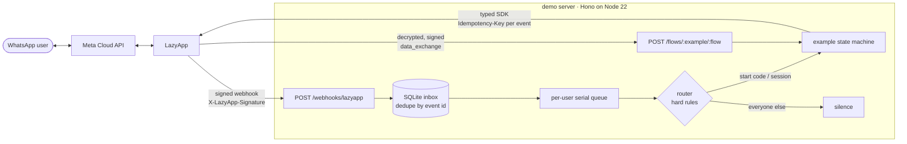

# LazyApp examples

Production-grade WhatsApp apps built on the [LazyApp](https://lazyapp.in) API: a storefront, food ordering, real estate, lead generation, a multi-tenant SaaS and more, each one a full end-to-end conversation using the Meta features a real business would use (catalogs, Flows, India payments, address forms, templates, carousels…).

Every example runs on one shared WhatsApp number behind one small server, and every example is a typed, fully tested state machine you can copy into your own product.

> **Try them on WhatsApp:** message **`DEMO`** to the LazyApp demo number to see every demo, or send a demo's start code (for example `DEMO HELLO`). Type `MENU` any time, `EXIT` to leave, `STOP` to opt out.

## Examples

<!-- examples:start -->

| Demo                                                     | Start code        | In one line                                                                                  | Meta features it leans on                                                                                                                                                                    |
| -------------------------------------------------------- | ----------------- | -------------------------------------------------------------------------------------------- | -------------------------------------------------------------------------------------------------------------------------------------------------------------------------------------------- |
| **Commerce**                                             |                   |                                                                                              |                                                                                                                                                                                              |
| [WhatsApp Shop](examples/whatsapp-shop)                  | `DEMO SHOP`       | A D2C store end to end: browse, cart, address, UPI or COD, tracking, returns.                | Catalog, product and multi-product messages, product carousel, India address message, `order_details` payments, returns Flow, coupon (limited-time offer) and opt-in cart reminder templates |
| [Food ordering](examples/food-ordering)                  | `DEMO FOOD`       | A cloud kitchen: nearest outlet, customise dishes, pay, follow the rider, book a table.      | Location request, customise Flow, scheduled orders, UPI or cash, rider location pin, table booking Flow (data exchange), reminder template                                                   |
| [Event tickets](examples/event-tickets)                  | `DEMO EVENTS`     | Discover events, book with a Flow, pay in WhatsApp, get a QR ticket, check in at the door.   | Media carousel, attendee Flow with live pricing, payments with seat holds, QR ticket PNG and PDF, location-header reminder, web check-in                                                     |
| **Leads and sales**                                      |                   |                                                                                              |                                                                                                                                                                                              |
| [Real estate](examples/real-estate)                      | `DEMO HOMES`      | Property search to a booked site visit, with EMI maths and an agent hand-off.                | Data-exchange Flows (preferences, EMI, slot booking), media carousel, brochure PDFs, location, contact card, location-header template, lead-score tags                                       |
| [Lead generation](examples/lead-generation)              | `DEMO LEADS`      | A B2B lead machine: attribution, qualification, scoring, CRM webhook, rep calendar, nurture. | Qualification Flow, calendar Flow, signed CRM webhook, contact tags, consented marketing templates with a copy-code coupon, `contact.opted_out`                                              |
| [Study abroad admissions](examples/education-admissions) | `DEMO ADMISSIONS` | Course finder to application fee, with document uploads and a parent view.                   | Course-finder Flow, program carousel, inbound documents and photos, application fee payment, image-header intake template                                                                    |
| **Services**                                             |                   |                                                                                              |                                                                                                                                                                                              |
| [Clinic appointments](examples/clinic-appointments)      | `DEMO CLINIC`     | Book a doctor on live slots, pay the fee, get reminders, prescriptions and refunds.          | Slot booking Flow (data exchange), consultation payments and refunds, reminder templates, pre-visit Flow, PDF documents                                                                      |
| [Support desk](examples/support-desk)                    | `DEMO SUPPORT`    | Self-service FAQs and order tracking, tickets with photos, agents in business hours, CSAT.   | Lists, CTA URL tracking page, inbound media, typing indicators, ticket-update template, CSAT Flow                                                                                            |
| [Login with WhatsApp](examples/otp-login)                | `DEMO OTP`        | One-time codes in chat and on a web sign-in page, with fraud guards and sign-in alerts.      | Authentication template (copy code, one tap), `POST /v1/otp` and `/v1/otp/verify`, `otp.verified` / `otp.failed` webhooks                                                                    |
| **Platforms**                                            |                   |                                                                                              |                                                                                                                                                                                              |
| [Build your own WhatsApp SaaS](examples/platform-saas)   | `DEMO PLATFORM`   | SalonBook, a fictional SaaS, onboards salons as LazyApp customers with their own numbers.    | Embedded Signup setup links, embedded inbox/templates/usage, per-customer usage, webhooks with the customer envelope, `X-LazyApp-Customer`, reply buttons, list, CTA URL                     |
| **Reference**                                            |                   |                                                                                              |                                                                                                                                                                                              |
| [Hello LazyApp](examples/_template)                      | `DEMO HELLO`      | The smallest complete example; copy it to start a new demo.                                  | Reply buttons, lists, reactions, location request, a Flow, follow-ups                                                                                                                        |

Send **`DEMO`** for a menu of every demo. The same list is served as JSON at `GET /demos` for the website.

<!-- examples:end -->

## How it works



1. LazyApp delivers a signed webhook. The server verifies the HMAC over the raw bytes, writes the event to a SQLite inbox (a redelivered event id is dropped), answers `202` and moves on.
2. A queue processes events per person in order, and different people in parallel.
3. The **router** enforces the shared-number rules before any example code runs (below).
4. The example's handler receives `ctx` and a normalised `inbound` message. All I/O goes through `ctx`: sends, flows, payments, state, storage.
5. Every send carries an `Idempotency-Key` derived from the inbound event id, so a replay after a crash makes LazyApp return the original message instead of sending it twice.

### Rules for a shared number

The demo number also carries real traffic (login codes, customers). The router guarantees:

| Rule                                       | How                                                                                                                                    |
| ------------------------------------------ | -------------------------------------------------------------------------------------------------------------------------------------- |
| Silent for everyone who did not opt in     | No session and no start code → no API call at all, not even a read receipt.                                                            |
| No unsolicited business-initiated messages | Examples only reply. Follow-ups need an explicit in-chat tap, go out as approved templates, and marketing ones need a recorded opt-in. |
| `MENU`, `EXIT`, `STOP` work everywhere     | Handled by the router, never reach an example. `STOP` also records an opt-out and cancels scheduled follow-ups.                        |
| Sessions end after 24h idle                | Then the person is a stranger again. Free-form sends outside the 24h window fail fast instead of costing a template.                   |
| One demo at a time                         | A new start code ends the current demo (and its follow-ups) first.                                                                     |

## Repository layout

```
packages/sdk        Typed LazyApp client: retries, idempotency, typed errors, webhook verification
packages/demo-kit   Example contract, router, SQLite store, UI builders, test harness
packages/setup      `npm run setup`: provisions templates, flows, webhook, starters, QR links
apps/demo-server    Hono server: webhooks, flow data endpoints, health, demo catalogue
examples/_template  The reference example every demo follows
examples/<name>     One directory per demo (auto-discovered)
deploy/             nginx, systemd and pm2 files for demo.lazyapp.in
```

## Run it yourself

You need Node **22.13+**, a LazyApp workspace with a connected WhatsApp number, and an API key.

```bash
git clone https://github.com/RahulSulegaokar/lazyapp-examples && cd lazyapp-examples
npm ci
cp .env.example .env              # add LAZYAPP_API_KEY and PUBLIC_BASE_URL

npm run setup -- --dry-run        # see what would be created; changes nothing
npm run setup                     # creates templates, flows, webhook, /commands, QR codes
                                  # → copy the printed LAZYAPP_WEBHOOK_SECRET into .env
npm run dev                       # http://localhost:8787, reloads on change
```

LazyApp needs to reach your server over HTTPS. Locally, run a tunnel (`cloudflared tunnel --url http://localhost:8787`) and set `PUBLIC_BASE_URL` to its URL before `npm run setup`.

Then send `DEMO` to your number.

| Command                   | Does                                                                         |
| ------------------------- | ---------------------------------------------------------------------------- |
| `npm run dev`             | Demo server with reload                                                      |
| `npm start`               | Demo server                                                                  |
| `npm run setup -- --help` | Provisioning options (`--only shop,food`, `--no-publish`, `--ice-breakers`…) |
| `npm test`                | Every test (SDK, router, server, examples)                                   |
| `npm run check`           | Lint + typecheck + test, as CI runs it                                       |

## Writing an example

Copy `examples/_template`, rename the id and start code, and write handlers. The whole contract:

```ts
export default defineExample<State>({
  id: 'shop',
  title: 'WhatsApp Store',
  startCode: 'DEMO SHOP',
  manifest,                    // templates, flows, webhook events, catalog/payment needs
  stateSchema,                 // zod: stored state is validated on every load
  initialState: () => ({ cart: [] }),
  describe: () => ({ summary: '…', metaFeatures: ['Catalog', 'Payments (India)'] }),
  async onStart(ctx, inbound) { await ctx.send.buttons({ … }) },
  async onMessage(ctx, inbound) { switch (inbound.kind) { … } },
  async onEvent(ctx, event) { /* payment.captured … */ },
  flowEndpoints: { checkout: async (ctx, request) => ({ screen: 'SUMMARY', data: { … } }) },
});
```

Tests drive the example like a person would and assert on the exact HTTP calls:

```ts
const h = createHarness(shop, { catalog: products, paymentConfiguration: 'demo-store' });
await h.user.send('DEMO SHOP');
await h.user.sendOrder([{ retailerId: 'kurta-indigo', quantity: 2 }]);
expect(h.callsTo('POST', '/v1/payments')[0]?.body).toMatchObject({ items: [{ quantity: 2 }] });
await h.payPayment();
expect(h.texts().at(-1)).toContain('Payment received');
```

See [CONTRIBUTING.md](CONTRIBUTING.md) for the full checklist.

## Deploy the demo server

One small VM with Node 22.13+ is enough: a single process, SQLite on local disk, behind nginx (the files are in [`deploy/`](deploy)). The examples need a public HTTPS origin, here `https://demo.lazyapp.in`: LazyApp posts webhooks and Flow data-exchange calls to it, and WhatsApp downloads brochures and tickets from it.

### 1. Prepare LazyApp

- **API key** (LazyApp → Settings → API keys). The server needs `messages:send`, `messages:read`, `flows:write` (the server looks flows up with `GET /v1/flows`) and `payments:write` (clinic refunds). `npm run setup` also needs `templates:read`, `templates:write`, `webhooks:write` and `connections:write` (conversation starters, QR codes). `catalog:write` only for the shop's optional `sync-catalog`.
- **Payments (optional)**: an active WhatsApp payment configuration on the number (India, `order_details`). Without one the shop, food, clinic, admissions and events demos fall back to a payment link through `PAYMENT_GATEWAY_ACCOUNT`, or cash, and say so in the chat.
- **Catalog (optional)**: a Meta catalog connected to the number holding the shop's and kitchen's `retailer_id`s (`npm run sync-catalog -w @lazyapp-examples/example-whatsapp-shop`, or Commerce Manager). Without one both demos use interactive lists and media carousels.

### 2. Install

```bash
sudo useradd --system --home /srv/lazyapp-examples lazyapp-demo
sudo git clone https://github.com/RahulSulegaokar/lazyapp-examples /srv/lazyapp-examples
cd /srv/lazyapp-examples && sudo npm ci --omit=dev
sudo install -o lazyapp-demo -m 600 .env.example .env    # then fill it in
sudo install -d -o lazyapp-demo data

sudo cp deploy/nginx.conf /etc/nginx/sites-available/demo.lazyapp.in
sudo ln -s /etc/nginx/sites-available/demo.lazyapp.in /etc/nginx/sites-enabled/
sudo certbot --nginx -d demo.lazyapp.in && sudo nginx -s reload

sudo -u lazyapp-demo npm run setup -- --dry-run   # shows what would be created
sudo -u lazyapp-demo npm run setup                 # templates, flows, webhook, /commands, QR codes
# → put the printed LAZYAPP_WEBHOOK_SECRET in .env, and each flow's data-endpoint secret
#   (LazyApp → Flows → the flow) in LAZYAPP_FLOW_SECRETS, then restart

sudo cp deploy/lazyapp-demo.service /etc/systemd/system/
sudo systemctl enable --now lazyapp-demo
journalctl -u lazyapp-demo -f            # JSON logs, phone numbers masked
curl -s https://demo.lazyapp.in/healthz
```

`npm run setup` creates the webhook at `${PUBLIC_BASE_URL}/webhooks/lazyapp` subscribed to exactly the events the loaded examples handle (`message.received`, `message.failed`, `payment.captured`, `payment.failed`, `contact.opted_out`, `otp.verified`, `otp.failed`), submits every template for Meta review and publishes every Flow with its data endpoint at `${PUBLIC_BASE_URL}/flows/<example>/<flow>`. It never sets ice breakers or /commands unless you pass `--ice-breakers` or `--commands`: they would show to every visitor of the shared number. Meta reviews templates in minutes to hours; re-run `npm run setup -- --dry-run` to see where each one stands. The admissions intake template has an image header and is created separately with `examples/education-admissions/src/provision-intake-template.ts`.

### 3. Check it

Send `DEMO` from a phone: you should get the demo list. A message without a start code must get no reply and no blue ticks.

Prefer pm2? `pm2 start deploy/ecosystem.config.cjs && pm2 save`. Run **one** instance: per-person ordering relies on the in-process queue.

Deploys are safe to do at any time: `SIGTERM` stops intake, drains the queue and closes SQLite; anything accepted but not processed stays in the inbox and is replayed on the next boot. `GET /healthz` is for your uptime monitor.

### Environment

| Variable                    | Required | Default                     | Notes                                                                |
| --------------------------- | -------- | --------------------------- | -------------------------------------------------------------------- |
| `LAZYAPP_API_KEY`           | yes      |                             | `sk_live_…` / `sk_test_…`                                            |
| `LAZYAPP_WEBHOOK_SECRET`    | yes      |                             | Printed once by `npm run setup`                                      |
| `PUBLIC_BASE_URL`           | yes\*    | `http://localhost:8787`     | HTTPS origin LazyApp calls (\*required by setup)                     |
| `LAZYAPP_BASE_URL`          |          | `https://lazyapp.in`        |                                                                      |
| `LAZYAPP_PHONE_NUMBER_ID`   |          |                             | Send from this number when the workspace has several                 |
| `LAZYAPP_CONNECTION_UUID`   |          | default connection          | Setup only                                                           |
| `LAZYAPP_FLOW_SECRETS`      |          | `{}`                        | `{"shop/checkout":"whfs_…"}`: per-flow data-endpoint signing secrets |
| `DEMO_PHONE_NUMBER`         |          |                             | E.164, for chat links on `GET /demos`                                |
| `DEMO_EXAMPLES`             |          | all                         | Comma-separated ids, in hub order                                    |
| `INCLUDE_REFERENCE_EXAMPLE` |          | `false`                     | Also run `DEMO HELLO`                                                |
| `PAYMENT_CONFIGURATION`     |          | auto-detected               | Active WhatsApp payment configuration (India)                        |
| `PAYMENT_GATEWAY_ACCOUNT`   |          |                             | Payment-link fallback (Cashfree / Razorpay account in LazyApp)       |
| `SESSION_IDLE_HOURS`        |          | `24`                        |                                                                      |
| `DATABASE_PATH`             |          | `./data/demo.sqlite`        |                                                                      |
| `HOST`, `PORT`, `LOG_LEVEL` |          | `127.0.0.1`, `8787`, `info` |                                                                      |

Per-example settings (all optional) are documented in [`.env.example`](.env.example) and each example's README: `OTP_LOGIN_ANDROID_PACKAGE` / `OTP_LOGIN_ANDROID_SIGNATURE_HASH` (one-tap autofill), `EVENT_TICKETS_STAFF_PIN`, `REAL_ESTATE_AGENT_PHONE` / `REAL_ESTATE_REMINDERS` / `REAL_ESTATE_USE_EVENTS`, `LEADS_CRM_WEBHOOK_URL` / `LEADS_CRM_WEBHOOK_SECRET` / `LEADS_TIMING` / `LEADS_USE_EVENTS` / `LEADS_REP_PHONE`, `PLATFORM_SAAS_API_KEY` / `PLATFORM_SAAS_WEBHOOK_SECRET` / `PLATFORM_SAAS_BOOK_CALL_URL` / `PLATFORM_SAAS_AUTOMATION_PACK` (the platform demo uses its own `sk_test_` key on a platform workspace).

### HTTP endpoints

| Route                        | Purpose                                                                         |
| ---------------------------- | ------------------------------------------------------------------------------- |
| `POST /webhooks/lazyapp`     | LazyApp webhooks (signature required)                                           |
| `POST /flows/:example/:flow` | WhatsApp Flow `data_exchange`, forwarded decrypted and signed by LazyApp        |
| `GET /healthz`               | Liveness, queue depth, loaded examples                                          |
| `GET /demos`                 | Public catalogue: titles, start codes, Meta features, `wa.me` links             |
| `GET, POST /x/:example/*`    | An example's own web pages (`web` routes): sign-in page, ticket files, check-in |
| `GET /public/:example/:file` | Files an example sends by URL (brochures, guides, sample PDFs) from `public/`   |

## License

[MIT](LICENSE)
