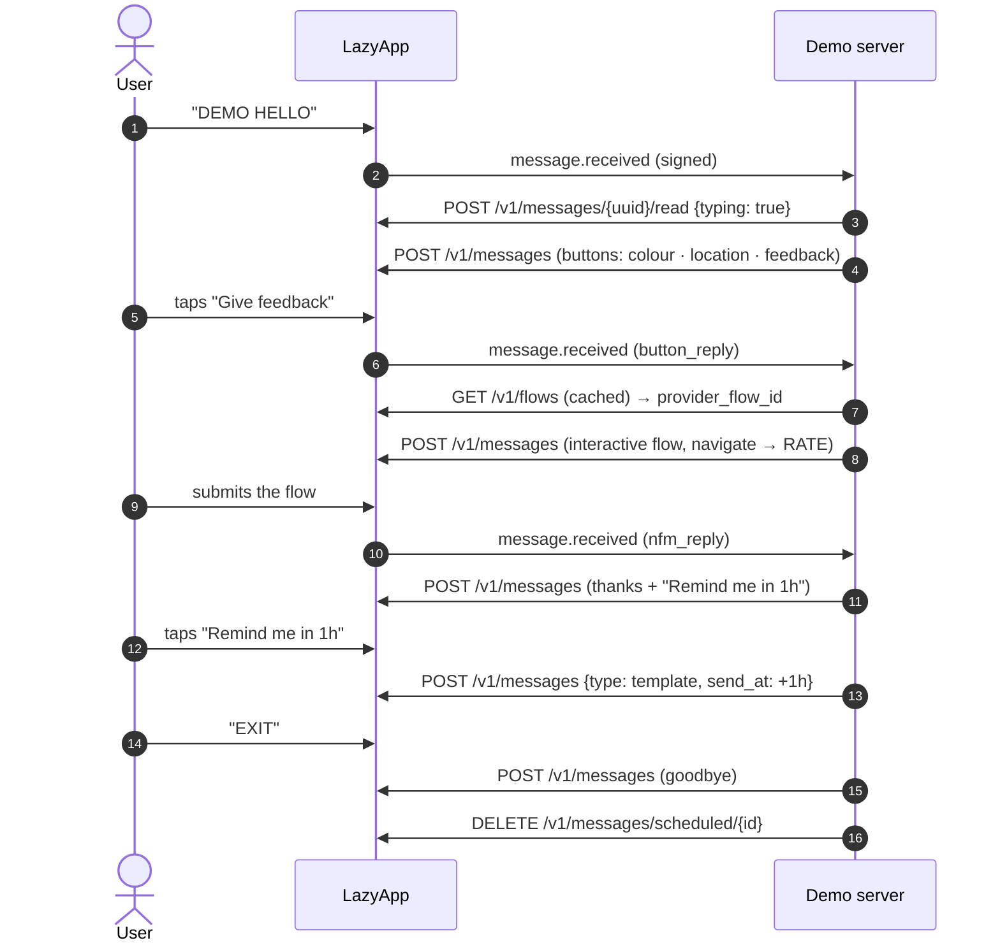

# Hello LazyApp (reference example)

The smallest complete LazyApp demo, and the pattern every other example follows. In a minute of chatting it shows reply buttons, a list, a reaction, a location request, a WhatsApp Flow with a button fallback, and a follow-up that only exists because the person asked for it.

## Try it

Send **`DEMO HELLO`** (or `/hello`) to the demo number. Run it locally with `INCLUDE_REFERENCE_EXAMPLE=true`.

## The conversation



## Meta features used

| Feature                      | Where                                 | LazyApp API                                                                               |
| ---------------------------- | ------------------------------------- | ----------------------------------------------------------------------------------------- |
| Read receipts + typing       | Every inbound message (router)        | `POST /v1/messages/{uuid}/read` `{ typing: true }`                                        |
| Reply buttons                | Menu, rating fallback, reminder offer | `POST /v1/messages` `interactive.type: button`                                            |
| List message                 | "Pick a colour"                       | `interactive.type: list`                                                                  |
| Reaction                     | Reacts 🎨 to the chosen colour        | `type: reaction` with the inbound `wamid`                                                 |
| Location request             | "Share location"                      | `interactive.type: location_request_message`                                              |
| Location                     | Office pin back                       | `type: location`                                                                          |
| WhatsApp Flow                | Feedback form (navigate, no endpoint) | `POST /v1/flows`, `…/publish`, `interactive.type: flow`                                   |
| Utility template + `send_at` | Reminder the user asked for           | `POST /v1/templates`, `POST /v1/messages` `send_at`, `DELETE /v1/messages/scheduled/{id}` |
| Conversation starter command | `/hello`                              | `PUT /v1/connections/{uuid}/conversation-starters`                                        |
| QR code / chat link          | Prefilled `DEMO HELLO`                | `POST /v1/connections/{uuid}/qr-codes`                                                    |

## Code tour

| File                  | What it shows                                                                                                     |
| --------------------- | ----------------------------------------------------------------------------------------------------------------- |
| `src/manifest.ts`     | Template and flow declarations that `npm run setup` provisions                                                    |
| `src/state.ts`        | zod-validated per-user state                                                                                      |
| `src/index.ts`        | `defineExample`: `onStart`, `onMenu`, `onMessage` switching on `inbound.kind`, `onEvent`                          |
| `flows/feedback.json` | Flow JSON 7.0, one screen, `complete` action                                                                      |
| `test/hello.test.ts`  | Harness tests: silence before the start code, every button, the flow, the fallback, EXIT cancelling the follow-up |

## Fallbacks

- **Flow not published** (`ctx.flows.isAvailable` is false): the same question as three reply buttons.
- **Template not approved yet**: scheduling still succeeds; the send fails at LazyApp and arrives as `message.failed`, which `onEvent` logs.

## Run it yourself

```bash
npm run setup -- --include-reference --only hello
INCLUDE_REFERENCE_EXAMPLE=true DEMO_EXAMPLES=hello npm run dev
npx vitest run examples/_template
```
