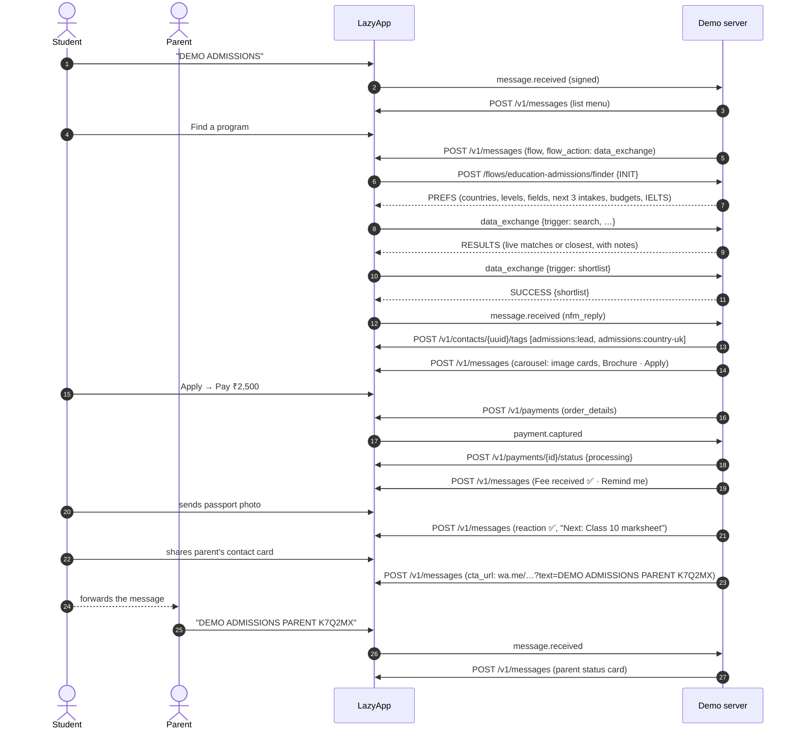

# Study abroad admissions (BrightPath Overseas)

The admissions desk of a study-abroad consultancy on WhatsApp, for overseas-education counsellors, university India offices, coaching institutes and schools. A student finds programs that fit their profile in a **WhatsApp Flow** matched live against 18 partner programs, compares them in a **carousel**, downloads brochures, books a free counselling session, sends their documents as photos and PDFs (each one acknowledged, filed and tagged), pays the application fee with **WhatsApp Pay**, and opts into deadline reminders. Parents follow progress through a private link, and students can opt into **intake announcements**, the broadcast a consultancy sends every intake.

BrightPath is fictional (offices in Pune, Bengaluru and Hyderabad). Universities and programs are real; tuition is indicative and labelled as such.

## Try it

Send **`DEMO ADMISSIONS`** (or `/admissions`) to the demo number, then:

1. **Find a program** → in the Flow pick _United Kingdom_, _Master's_, _Data Science_, _Sep–Dec 2027_, _₹25–35 lakh_, IELTS _6.5_ → tick the match → **Shortlist**.
2. Tap **Brochure** (PDF), then **Apply** → **Pay ₹2,500** (or _Pay at counselling_) → **Remind me** before the deadline.
3. **Free counselling call** → pick a time → _Phone call_ (you get the counsellor's contact card) or _Visit Pune office_ (you get the pin).
4. **Documents** → pick _Passport_ and send a photo. The next missing document is requested automatically; send any file unprompted and you are asked what it is.
5. **Add a parent** → share a contact card. Forward the link; when your parent sends its prefilled text (`DEMO ADMISSIONS PARENT <code>`), they see your progress.
6. **Intake alerts** → _Yes, send alerts_ records consent and sends the image-header announcement template.

`MENU` shows the menu, `EXIT` ends the demo, `STOP` ends it and opts you out.

## The conversation



## Meta features used

| Feature                                | Where in the flow                                                                 | LazyApp API                                                                                    |
| -------------------------------------- | --------------------------------------------------------------------------------- | ---------------------------------------------------------------------------------------------- |
| WhatsApp Flow with data endpoint       | Course finder: dropdowns from INIT, live matching, shortlist                      | `POST /v1/flows` (`data_endpoint_uri`), `interactive.type: flow`, `flow_action: data_exchange` |
| Media carousel                         | Shortlisted programs with image headers and quick replies                         | `interactive.type: carousel` (image cards, `quick_reply` buttons)                              |
| Reply buttons with image header        | A single matching program                                                         | `interactive.type: button`, `header.type: image`                                               |
| List messages                          | Menu, finder fallback, counselling slots, documents, scholarships                 | `interactive.type: list`                                                                       |
| CTA URL buttons                        | Official scholarship pages; the parent link (`wa.me` prefill)                     | `interactive.type: cta_url`                                                                    |
| Documents                              | Country brochures, the checklist PDF                                              | `type: document` with `media_url`                                                              |
| Inbound media                          | Student uploads passport, marksheets… as photos or PDFs                           | `message.received` with `type: image` or `document`                                            |
| Inbound contact cards                  | Student shares a parent's contact                                                 | `message.received` with `type: contacts`                                                       |
| Outbound contact cards                 | Counsellor's card                                                                 | `type: contacts`                                                                               |
| Location                               | Office pin for in-person counselling                                              | `type: location`                                                                               |
| Reactions                              | ✅ on every filed document, ⚠️ on an unsupported file                             | `type: reaction`                                                                               |
| Payments (India), `order_details`      | ₹2,500 application fee, retry with a fresh reference                              | `POST /v1/payments`, `POST /v1/payments/{id}/status`                                           |
| Utility templates + scheduled send     | Counselling reminder (1h before), deadline reminders (7d, 1d)                     | `POST /v1/messages` with `send_at`, `DELETE /v1/messages/scheduled/{id}`                       |
| Marketing template with image header   | Intake announcement after opt-in; broadcast-ready                                 | `POST /v1/templates/media`, `POST /v1/templates`, `type: template` with a header image         |
| Template quick-reply payloads          | Reminders and the announcement route back into the demo                           | `components[].sub_type: quick_reply`                                                           |
| Marketing consent                      | Intake alerts opt-in and opt-out                                                  | `POST /v1/contacts/{uuid}/consent`                                                             |
| Contact tags (segments for broadcasts) | `admissions:lead`, `:country-uk`, `:docs-complete`, `:fee-paid`, `:intake-alerts` | `POST` / `DELETE /v1/contacts/{uuid}/tags`                                                     |
| Read receipts + typing                 | Every inbound message                                                             | `POST /v1/messages/{uuid}/read` `{ typing: true }`                                             |
| Conversation starter, QR link          | `/admissions`, prefilled `DEMO ADMISSIONS`                                        | `PUT /v1/connections/{uuid}/conversation-starters`, `POST /v1/connections/{uuid}/qr-codes`     |

## LazyApp API calls

| Call                                      | Body (abridged)                                                                                                                                                                                                                                                                                |
| ----------------------------------------- | ---------------------------------------------------------------------------------------------------------------------------------------------------------------------------------------------------------------------------------------------------------------------------------------------- |
| `POST /v1/messages` (carousel)            | `{ to, type: 'interactive', interactive: { type: 'carousel', body, action: { cards: [{ card_index, type: 'cta_url', header: { type: 'image', image: { link } }, body, action: { buttons: [{ type: 'quick_reply', quick_reply: { id: 'prog:apply:leeds-msc-ds', title: 'Apply' } }] } }] } } }` |
| `POST /flows/education-admissions/finder` | Data endpoint: `INIT` → `PREFS`; `{ trigger: 'search', country, level, field, intake, budget, ielts }` → `RESULTS`; `{ trigger: 'shortlist', shortlist: [...] }` → `SUCCESS`                                                                                                                   |
| `POST /v1/payments`                       | `{ to, reference_id: 'BP27-K7Q2MX', goods_type: 'digital-goods', expires_in_minutes: 60, items: [{ name: 'Application fee · Leeds', amount: 250000, quantity: 1 }], payment: { method: 'payment_gateway', configuration }, metadata: { application_ref } }`                                    |
| `POST /v1/payments/{id}/status`           | `{ status: 'processing', description: 'Application BP27-K7Q2MX is being filed' }`                                                                                                                                                                                                              |
| `POST /v1/contacts/{uuid}/tags`           | `{ tags: ['admissions:lead', 'admissions:country-uk'] }`                                                                                                                                                                                                                                       |
| `DELETE /v1/contacts/{uuid}/tags`         | `{ tags: ['admissions:docs-in-progress'] }`                                                                                                                                                                                                                                                    |
| `POST /v1/contacts/{uuid}/consent`        | `{ granted: true, channel: 'whatsapp', purpose: 'marketing', consent_text, captured_by: 'lazyapp-examples:education-admissions' }`                                                                                                                                                             |
| `POST /v1/messages` (template)            | `{ type: 'template', template: { name: 'demo_education_admissions_intake_announcement', language: 'en', components: [{ type: 'header', parameters: [{ type: 'image', image: { link } }] }, { type: 'body', parameters: [4 × text] }, quick_reply payloads] } }`                                |
| `POST /v1/messages` (scheduled)           | `{ type: 'template', template: { name: 'demo_education_admissions_deadline_reminder', … }, send_at }`                                                                                                                                                                                          |

### Templates

| Name                                             | Category  | Provisioned by                     | Body                                                                                                                                                                                                                                                                                                              |
| ------------------------------------------------ | --------- | ---------------------------------- | ----------------------------------------------------------------------------------------------------------------------------------------------------------------------------------------------------------------------------------------------------------------------------------------------------------------- |
| `demo_education_admissions_deadline_reminder`    | Utility   | `npm run setup`                    | Hi {{1}}, the application deadline for {{2}} ({{3}} intake) is {{4}}. Reply here to finish any pending documents with your counsellor. · Quick replies: Upload documents, Talk to counsellor                                                                                                                      |
| `demo_education_admissions_counselling_reminder` | Utility   | `npm run setup`                    | Hi {{1}}, your counselling call with {{2}} is today at {{3}}. Keep your marksheets and passport handy so we can shortlist universities together. · Quick reply: Upload documents                                                                                                                                  |
| `demo_education_admissions_intake_announcement`  | Marketing | `src/provision-intake-template.ts` | Image header · Hi {{1}}, applications for the {{2}} intake are now open at {{3}} partner universities in the UK, Canada, Australia, Germany, Ireland and the USA. Early applicants can get scholarships worth up to {{4}}. Check your eligibility in two minutes. · Quick replies: Check eligibility, Stop alerts |

The announcement has an image header, and Meta reviews a sample of every media header. `npm run setup` only sends JSON, so a small script uploads the sample (`POST /v1/templates/media`, multipart) and creates the template with the returned `example_handle`:

```bash
npx tsx --env-file=.env examples/education-admissions/src/provision-intake-template.ts --dry-run
npx tsx --env-file=.env examples/education-admissions/src/provision-intake-template.ts
```

### Broadcasting the intake announcement

Everyone who tapped _Yes, send alerts_ has granted marketing consent and carries the `admissions:intake-alerts` tag. Make a segment on that tag once in the console (**Contacts → Segments**, tag _admissions:intake-alerts_), then broadcast with the image as the header:

> `POST /v1/contact-segments` filters tags by internal integer ids (`filters.tags.ids`), which `GET /v1/tags` does not return, so the segment cannot be created through the API yet. This is reported as a LazyApp gap.

```bash
curl https://lazyapp.in/v1/broadcasts -H "Authorization: Bearer $LAZYAPP_API_KEY" \
  -H "Content-Type: application/json" \
  -d '{
    "name": "Sep 2027 intake open",
    "template_name": "demo_education_admissions_intake_announcement",
    "language": "en",
    "contact_segment_uuid": "<segment uuid>",
    "variable_map": {
      "header_media": "https://images.unsplash.com/photo-1541339907198-e08756dedf3f?w=800&q=80&auto=format&fit=crop",
      "body": [{ "source": "contact_attribute", "key": "first_name" }, "Sep–Dec 2027", "18", "₹10 lakh"]
    },
    "quiet_hours": { "start": "21:00", "end": "09:00", "timezone": "Asia/Kolkata" },
    "start": true
  }'
```

LazyApp only sends to contacts with granted marketing consent and skips everyone else (`stats.excluded`).

## Design notes

- **One matcher, two front ends.** `src/finder.ts` is pure: the Flow endpoint and the list fallback call the same `matchPrograms`, so both give the same answer. When nothing matches every preference, it ranks by country, field, budget, English and intake and says so.
- **Intakes move with the calendar.** Only starts at least ten weeks away are offered (the application deadline), so the Flow never lists an intake you cannot make.
- **Documents never block.** Each upload is filed, reacted to and tagged, and the next missing document is requested; an unprompted file gets a "which document is this?" list. Only JPG, PNG and PDF are accepted.
- **Parents pull, the number never pushes.** The shared number never messages anyone who did not write first, so the student forwards a private `wa.me` link (bound to the parent's number when the contact card has one, valid 7 days). The parent sees progress, never the documents.
- **Counselling slots are shared.** A session booked by one student disappears for others; changing a booking frees the old slot.

## Fallbacks

| Missing                                    | What happens                                                                                                             |
| ------------------------------------------ | ------------------------------------------------------------------------------------------------------------------------ |
| `finder` Flow not published                | Four list/button questions (country, level, budget, IELTS), the same matcher, the same carousel. The chat says why.      |
| One match                                  | A single image card instead of a carousel (carousels need two cards).                                                    |
| No payment configuration                   | With `PAYMENT_GATEWAY_ACCOUNT`: a payment link. Otherwise the fee is marked _due at counselling_, and the chat says why. |
| Payment request refused                    | Same as above, with LazyApp's reason.                                                                                    |
| Payment fails                              | "Try again" (a new `reference_id`) or "Pay at counselling".                                                              |
| Intake template not approved / not created | The same announcement as an interactive message with an image header, labelled as a preview.                             |
| No contact uuid (username-only user)       | Tags and consent are skipped; the conversation is unchanged.                                                             |

## Limitations

- Deadline and counselling reminders are follow-ups of the demo session: EXIT, STOP or 24 hours idle cancel them. A production consultancy would schedule them against the application, not the chat.
- Meta's Flow `CheckboxGroup` titles are cut to 30 characters, so programs show as "MSc Data Science · Leeds" in the Flow and in full in the carousel.
- Brochures are one PDF per country, served from `public/` by the demo server (`GET /public/education-admissions/<file>`), so `PUBLIC_BASE_URL` must be reachable by WhatsApp.

## Run it yourself

```bash
npm run setup -- --only education-admissions        # utility templates + the finder flow
npx tsx --env-file=.env examples/education-admissions/src/provision-intake-template.ts
DEMO_EXAMPLES=education-admissions npm run dev
npx vitest run examples/education-admissions
```

| Env                       | Needed for                                                                                               |
| ------------------------- | -------------------------------------------------------------------------------------------------------- |
| `LAZYAPP_API_KEY`         | Everything. Scopes: `messages:send`, `messages:read`, `templates:write`, contacts write (tags, consent). |
| `PUBLIC_BASE_URL`         | Flow data endpoint (`/flows/education-admissions/finder`) and brochure PDFs.                             |
| `LAZYAPP_FLOW_SECRETS`    | `{"education-admissions/finder": "<signing secret from LazyApp → Flows>"}`                               |
| `PAYMENT_CONFIGURATION`   | Optional: WhatsApp Pay configuration name. Auto-detected when empty.                                     |
| `PAYMENT_GATEWAY_ACCOUNT` | Optional: Cashfree/Razorpay account id for the payment-link fallback.                                    |

## Code tour

| File                               | What it does                                                                                               |
| ---------------------------------- | ---------------------------------------------------------------------------------------------------------- |
| `src/catalog.ts`                   | Countries, levels, fields, budgets, 18 programs, scholarships, counsellors, the document checklist         |
| `src/finder.ts`                    | Pure matching, intake seasons, next starts and deadlines                                                   |
| `src/finder-endpoint.ts`           | Data endpoint of the `finder` Flow: INIT → PREFS, `search` → RESULTS, `shortlist` → SUCCESS                |
| `src/programs.ts`                  | Finder (Flow or lists), carousel / single card, brochures, scholarships, lead tags                         |
| `src/counselling.ts`               | Shared session slots, phone or office, counsellor card, reminder                                           |
| `src/documents.ts`                 | Checklist, uploads, classification of unprompted files, progress tags                                      |
| `src/application.ts`               | Intake choice, summary, fee payment and events, deadline reminders                                         |
| `src/guardian.ts`                  | Private parent links, number binding, the parent status view                                               |
| `src/alerts.ts`                    | Marketing opt-in/out, consent records, tags, the announcement template (with preview fallback)             |
| `src/provision-intake-template.ts` | Uploads the header sample and creates the image-header marketing template                                  |
| `test/*.test.ts`                   | 35 conversation tests: every branch, fallback, payment event, parent edge case and the provisioning script |
