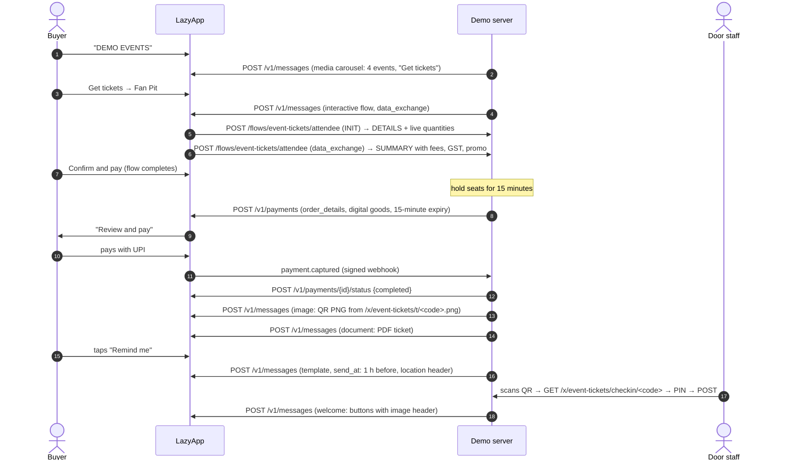

# LazyApp Events (ticketing and check-in)

Event ticketing that never leaves WhatsApp, the way Indian organisers increasingly sell comedy nights, gigs, meet-ups and food festivals: discover events in a **media carousel**, pick a tier with **live availability** (or join the **waitlist**), add attendee details in a **WhatsApp Flow** whose data endpoint prices the order live (promo codes, booking fee, GST), pay with an **India payment request** while seats are **held for 15 minutes**, and receive a **QR ticket rendered by the server** as an image and a PDF. Then add it to your calendar, get the venue pin, opt into **reminders** (an hour before, with a map), see a **live update**, get **checked in at the door** by staff scanning the QR on any phone (which sends a welcome message to the chat), and rate the night afterwards with a link to the photo gallery.

## Try it

1. Send **`DEMO EVENTS`** (or `/events`) to the demo number.
2. Swipe the carousel and tap **Get tickets** on _Late Night Laughs_ (always tonight or tomorrow night).
3. Pick a tier, fill in the Flow (try promo `LAZY20`, or `EARLY100` for Monsoon Indie Nights) and confirm.
4. Pay with **Review and pay** (or **Simulate payment** if the number has no payment setup).
5. Your QR ticket and PDF arrive. Tap **Remind me**, **Add to calendar**, **Venue & directions**.
6. Play the door staff: **Try check-in** opens the check-in screen; enter PIN **`2468`** and tap **Check in**. The welcome message lands in the chat.
7. **Rate the event** and open the photos. Try the sold-out **VIP** tier to join the waitlist.

## The journey



## Meta features used

| Feature                              | Where                                                    | LazyApp API                                                                                                           |
| ------------------------------------ | -------------------------------------------------------- | --------------------------------------------------------------------------------------------------------------------- |
| Media carousel                       | Event discovery, one card per event, 2 quick replies     | `POST /v1/messages` `interactive.type: carousel`                                                                      |
| Reply buttons with an image header   | Event card with a button per tier; welcome at the door   | `interactive.type: button`, `header.type: image`                                                                      |
| WhatsApp Flow with a data endpoint   | Attendee details, quantity, promo, live price summary    | `POST /v1/flows` (setup), `interactive.type: flow` `flow_action: data_exchange`, `POST /flows/event-tickets/attendee` |
| Payments (India)                     | `order_details` with items, fee, GST, discount, expiry   | `POST /v1/payments`, `payment.captured` / `payment.failed` webhooks                                                   |
| Order status                         | "Completed: tickets issued" on the WhatsApp order        | `POST /v1/payments/{id}/status`                                                                                       |
| Refunds                              | Payment after a lapsed hold, or paying twice             | `POST /v1/payments/{id}/refund`                                                                                       |
| Cancel a pending order               | The buyer cancels: the Review and pay card stops working | `POST /v1/payments/{id}/status` `{status: canceled}`                                                                  |
| Image message                        | The QR ticket (PNG rendered by the demo server)          | `type: image` `media_url`                                                                                             |
| Document message                     | The PDF ticket (rendered by the demo server)             | `type: document` `media_url`, `filename`                                                                              |
| CTA URL buttons                      | Add to calendar, staff check-in screen, photo gallery    | `interactive.type: cta_url`                                                                                           |
| Location                             | Venue pin                                                | `type: location`                                                                                                      |
| Utility templates + `send_at`        | Hour-before reminder, post-event rating                  | `POST /v1/messages` `type: template, send_at`; `DELETE /v1/messages/scheduled/{id}`                                   |
| Location header template             | The hour-before reminder shows the venue map             | `header: { format: LOCATION }`, `header` parameter `type: location`                                                   |
| Template quick replies with payloads | "Show my ticket", "Loved it / OK / Not great"            | `components[].sub_type: quick_reply` `payload`                                                                        |
| Contact tags (broadcast segment)     | `event:<id>`, `event-updates:<id>`, `waitlist:<id>`      | `POST /v1/contacts/{uuid}/tags`                                                                                       |
| Reactions                            | 📝 waitlist, 😍 rating                                   | `type: reaction`                                                                                                      |
| List message                         | My tickets                                               | `interactive.type: list`                                                                                              |
| Conversation starter command         | `/events`                                                | `PUT /v1/connections/{uuid}/conversation-starters`                                                                    |

## LazyApp API calls

```http
POST /v1/payments
Idempotency-Key: <event id>:event-tickets:payment:MIN-24051:1
{
  "to": "+919812345670",
  "reference_id": "MIN-24051-1",
  "body": "Monsoon Indie Nights · Fan Pit × 2\nSun, 25 Oct, 7:00 pm · Bandstand Amphitheatre, Bandra West\nSeats held for 15 minutes.",
  "header_image_url": "https://images.unsplash.com/…",
  "goods_type": "digital-goods",
  "expires_in_minutes": 15,
  "items": [
    { "name": "Monsoon Indie Nights · Fan Pit", "amount": 149900, "quantity": 2, "retailer_id": "indie.pit" },
    { "name": "Booking fee", "amount": 3000, "quantity": 2, "retailer_id": "booking-fee" }
  ],
  "tax": { "amount": 1080, "description": "GST 18% on the booking fee" },
  "discount": { "amount": 50000, "description": "LAZY20: 20% off tickets, up to ₹500", "program_name": "LAZY20" },
  "payment": { "method": "payment_gateway", "configuration": "demo-store" },
  "metadata": { "demo": "event-tickets", "booking": "MIN-24051", "session": "…" }
}

POST /v1/payments/{id}/status   { "status": "completed", "description": "Tickets issued: booking MIN-24051" }
POST /v1/payments/{id}/refund   { "amount": 560640 }

POST /v1/messages   { "type": "image", "media_url": "https://demo.lazyapp.in/x/event-tickets/t/<code>.png", "caption": "🎟️ …" }
POST /v1/messages   { "type": "document", "media_url": "https://demo.lazyapp.in/x/event-tickets/t/<code>.pdf", "filename": "Ticket-MIN-24051.pdf" }

POST /v1/messages   (hour-before reminder)
{ "type": "template", "send_at": "…", "template": { "name": "demo_event_tickets_starting", "language": "en", "components": [
  { "type": "header", "parameters": [{ "type": "location", "location": { "latitude": "28.5535", "longitude": "77.1946", "name": "Punchline Room", "address": "Hauz Khas Village, New Delhi" } }] },
  { "type": "body", "parameters": [{ "type": "text", "text": "Late Night Laughs" }, { "type": "text", "text": "LNL-24051" }] },
  { "type": "button", "sub_type": "quick_reply", "index": "0", "parameters": [{ "type": "payload", "payload": "tk:show:LNL-24051" }] } ] } }
```

Templates created by `npm run setup` (all UTILITY, English):

| Name                          | Header   | Body                                                                                                                                           | Buttons                          |
| ----------------------------- | -------- | ---------------------------------------------------------------------------------------------------------------------------------------------- | -------------------------------- |
| `demo_event_tickets_reminder` |          | Hi {{1}}, see you tomorrow at {{2}}! Doors open at {{3}}; the venue is {{4}}. Your ticket is saved in this chat, so there is nothing to print. | Show my ticket                   |
| `demo_event_tickets_starting` | LOCATION | Starting in an hour: {{1}}. Doors are open, so keep the QR code of booking {{2}} ready at the gate. Tap the map for directions.                | Show my ticket                   |
| `demo_event_tickets_update`   |          | Update for {{1}} ticket holders: {{2}} Reply MENU for your ticket and the venue map.                                                           |                                  |
| `demo_event_tickets_feedback` |          | Thanks for coming to {{1}}! How was it, {{2}}? Your rating goes straight to the organisers.                                                    | Loved it · It was OK · Not great |

Meta may reclassify the feedback template as MARKETING; if it does, schedule it only after `ctx.consent.optInToMarketing(...)`.

## How it holds up

- **Inventory** (`src/box-office.ts`): capacity − sold − live holds. Every read-modify-write is synchronous SQLite, so two buyers cannot both take the last seat.
- **Holds** last 15 minutes and match the payment request's `expires_in_minutes`. A payment that arrives after the hold lapsed still gets tickets if seats remain; otherwise it is **refunded automatically**. A second payment for the same booking (an old request paid after a retry) is refunded too.
- **Webhooks are idempotent**: a redelivered `payment.captured` never sends tickets twice; a `payment.failed` for an older attempt is ignored.
- **Tickets**: one QR per booking ("Admit 2"), pointing at the staff check-in URL. The URL carries a 96-bit secret code, never the booking id or the phone number. The PNG and PDF are generated on request with no native dependencies (`src/render.ts`: QR matrix from `uqr`, PNG chunks with `node:zlib`, a hand-written PDF with vector modules).
- **Check-in** needs the staff PIN (rate-limited per IP), works once (a second scan says when the first was), refuses cancelled tickets and finished events, and messages the guest only through `web.notify`, which can only reach someone in a live demo chat.
- **Dates** are relative to now, and each booking snapshots its event's start time, so "tonight" never moves under a ticket holder.

## Fallbacks

| Missing                               | What happens                                                                                                      |
| ------------------------------------- | ----------------------------------------------------------------------------------------------------------------- |
| Payment setup (`payments() === null`) | A clearly labelled **Simulate payment** button issues the tickets; the chat says payments are not set up.         |
| LazyApp refuses the payment request   | Same simulated checkout, with LazyApp's reason in the chat (e.g. payment terms not accepted).                     |
| Attendee Flow not published           | Quantity buttons (1 / 2 / 4); the WhatsApp profile name goes on the ticket.                                       |
| Event beyond the 24h session          | Reminders are acknowledged but not scheduled, and the chat says why (sessions cancel their follow-ups on expiry). |
| Guest not in a live chat at the door  | Check-in works; no WhatsApp message is sent, and the staff screen says so.                                        |

## Web pages

| Route                                       | For                                                                  |
| ------------------------------------------- | -------------------------------------------------------------------- |
| `GET /x/event-tickets/t/<code>.png`         | The QR image WhatsApp fetches                                        |
| `GET /x/event-tickets/t/<code>.pdf`         | The PDF ticket                                                       |
| `GET, POST /x/event-tickets/checkin/<code>` | Door staff: verdict (valid / already in / not valid), PIN, check in  |
| `GET /x/event-tickets/scan`                 | Camera scanner for staff phones (`BarcodeDetector`), or paste a link |
| `GET /x/event-tickets/gallery/<event>`      | Post-event photos                                                    |

## Live updates in production

The **Live updates** button sends the `demo_event_tickets_update` template to the person who tapped it, because a demo on a shared number must never message anyone else. In production, organisers send it to every ticket holder at once: every buyer is tagged `event:<id>`, so create a contact segment on that tag and `POST /v1/broadcasts` with `template_name: demo_event_tickets_update` and the segment id. LazyApp applies opt-outs and frequency caps when the broadcast runs. The waitlist works the same way: `waitlist:<id>` is the segment to offer released seats to.

## Platform gaps found

| Endpoint                        | Problem                                                                                                                                                                                                                                                                                                   | Suggested fix                                                                                                                                 |
| ------------------------------- | --------------------------------------------------------------------------------------------------------------------------------------------------------------------------------------------------------------------------------------------------------------------------------------------------------- | --------------------------------------------------------------------------------------------------------------------------------------------- |
| `POST /v1/broadcasts` (OpenAPI) | The API accepts `contact_segment_uuid` (and the guide recommends it), but `openapi.json` only lists the integer `contact_segment_id`; `POST /v1/contact-segments` types `filters` as a bare `object`, and the guide shows only an `attribute` filter, not the `tags` filter this example's segment needs. | Add `contact_segment_uuid` to the schema and document every filter shape (`tags`, `attribute`, `consent_status`, `suppressed`) with examples. |

## Run it yourself

```bash
npm run setup -- --only event-tickets     # 4 templates + the attendee flow (data endpoint: $PUBLIC_BASE_URL/flows/event-tickets/attendee)
DEMO_EXAMPLES=event-tickets npm run dev
npx vitest run examples/event-tickets
```

| Variable                  | Required     | Default | Notes                                                                                 |
| ------------------------- | ------------ | ------- | ------------------------------------------------------------------------------------- |
| `EVENT_TICKETS_STAFF_PIN` |              | `2468`  | PIN on the check-in page. The demo shows it in the chat; change it for anything real. |
| `PAYMENT_CONFIGURATION`   |              | auto    | Active WhatsApp payment configuration (India)                                         |
| `PAYMENT_GATEWAY_ACCOUNT` |              |         | Cashfree / Razorpay account for the payment-link fallback                             |
| `LAZYAPP_FLOW_SECRETS`    | for the Flow | `{}`    | Include `"event-tickets/attendee": "whfs_…"`                                          |

`PUBLIC_BASE_URL` must be reachable by Meta: WhatsApp downloads the ticket image and PDF from it. The API key needs `messages:send`, `payments:write`, `templates:write` (setup) and `messages:read`.
