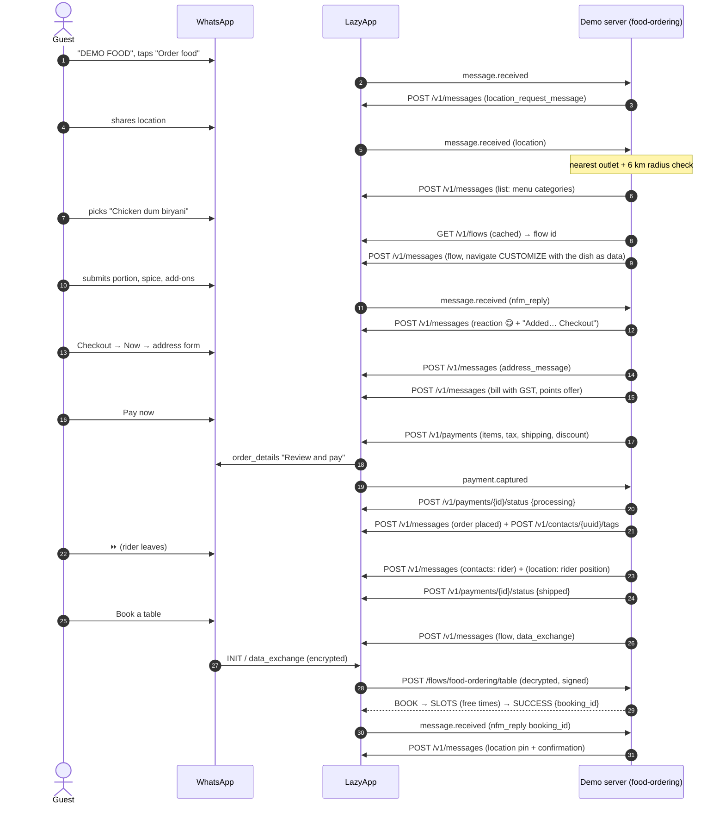

# Food ordering: a cloud kitchen in a chat

**Masala Mile** is a fictional Bengaluru cloud kitchen with three outlets (Indiranagar, Koramangala, HSR Layout). A guest shares a location, gets the nearest kitchen and an honest delivery estimate (or a pickup offer when they are outside the 6 km radius), browses the menu, customises a biryani in a WhatsApp Flow (portion, spice, add-ons, cooking notes), orders for now or later, pays by UPI inside WhatsApp or cash, and watches the order go from kitchen to door with the rider's contact card and position. The same chat books a table with live availability, keeps loyalty points, collects a rating from a single emoji and repeats the last meal in one tap.

It is the flow Indian restaurants and cloud kitchens run on aggregator apps, moved into the channel their customers already open fifty times a day, without aggregator commissions.

## Try it

Send **`DEMO FOOD`** (or `/food`) to the LazyApp demo number. Then:

1. **Order food** → share your location (or type _Koramangala_).
2. **Biryani** → **Chicken dum biryani** → customise it in the form → **Checkout**.
3. **Now** (or **Schedule for later**) → add your flat number → **Use 100 points** → **Pay now · UPI** or **Cash on delivery**.
4. Tap **⏩ Kitchen update** to play the kitchen: accepted, cooking, rider on the way (contact card and live pin), delivered.
5. React 😋 to the "Delivered" message. Next time, the welcome has **Reorder last meal**.
6. **Book a table**: pick a restaurant, date and guests; the Flow shows only the times with free tables.

`MENU` shows the menu, `EXIT` leaves, `STOP` leaves and opts out. Kitchens are "open" 11 am – 11 pm IST; outside those hours the demo only takes scheduled orders, as a real kitchen would.

## The conversation



## Meta features used

| Feature                          | Where in the flow                                             | LazyApp API                                                                |
| -------------------------------- | ------------------------------------------------------------- | -------------------------------------------------------------------------- |
| Location request                 | "Order food": find the nearest kitchen                        | `interactive.type: location_request_message`                               |
| Inbound location                 | Radius check, nearest outlet, ETA                             | inbound `type: location`                                                   |
| Location messages                | Kitchen pin (out of range, pickup, booking), rider's position | `type: location`                                                           |
| List messages                    | Menu, dishes, schedule slots, bookings, ratings               | `interactive.type: list`                                                   |
| Reply buttons with image header  | Welcome, order placed, fallbacks                              | `interactive.type: button`                                                 |
| WhatsApp Flow (navigate + data)  | Dish customisation: the dish is passed as screen data         | `flow_action: navigate`, `flow_action_payload.data`                        |
| WhatsApp Flow (data_exchange)    | Table booking with live availability and atomic reservation   | `POST /flows/food-ordering/table`, `flow_action: data_exchange`, `SUCCESS` |
| Multi-product message            | Menu, when the catalog holds the `ml-…` items                 | `interactive.type: product_list`                                           |
| Catalog cart (`order` message)   | Cart sent from the catalog                                    | inbound `type: order`                                                      |
| India address message            | Flat number and landmark for the rider                        | `interactive.type: address_message`, `validation_errors`                   |
| Payments (India) `order_details` | Pay now: UPI, with GST as tax and packaging as shipping       | `POST /v1/payments`                                                        |
| Order status                     | processing → shipped (rider out) → completed                  | `POST /v1/payments/{id}/status`                                            |
| Contact cards                    | Rider, help desk                                              | `type: contacts`                                                           |
| Reactions (sent and received)    | 😋 on add, ✅ on order; an emoji on "Delivered" is a rating   | `type: reaction`, inbound `type: reaction`                                 |
| Utility template + `send_at`     | Table reminder 2 h before, only on request                    | `POST /v1/messages` `send_at`, `DELETE /v1/messages/scheduled/{id}`        |
| Template quick replies           | "Get directions" / "Cancel booking" on the reminder           | `components[].sub_type: quick_reply` payloads                              |
| Contact tags                     | `demo-food-feedback`, `demo-food-support`                     | `POST /v1/contacts/{uuid}/tags`                                            |
| Contact tags                     | `demo-food-customer` on every order, for segments             | `POST /v1/contacts/{uuid}/tags`                                            |
| Read receipts + typing           | Every inbound message (router)                                | `POST /v1/messages/{uuid}/read`                                            |
| Conversation starter + QR        | `/food`, QR prefilled with `DEMO FOOD`                        | setup: `PUT …/conversation-starters`, `POST …/qr-codes`                    |

## LazyApp API calls

```http
POST /v1/payments
{
  "to": "+919800000001",
  "reference_id": "MM48213",
  "body": "Order MM48213 from Masala Mile Koramangala. Pay with any UPI app and we start cooking.",
  "goods_type": "physical-goods",
  "importer": { "name": "Masala Mile Foods LLP", "address": { … } },
  "expires_in_minutes": 15,
  "items": [{ "name": "Chicken dum biryani (Full, Spicy, + Extra raita, + Boiled…", "amount": 50400, "quantity": 2, "retailer_id": "ml-chicken-biryani", "country_of_origin": "India" }],
  "tax": { "amount": 4790, "description": "GST 5%" },
  "shipping": { "amount": 2000, "description": "Packaging" },
  "discount": { "amount": 5000, "description": "100 Club points", "program_name": "Masala Mile Club" },
  "payment": { "method": "payment_gateway", "configuration": "masala-mile" },
  "metadata": { "demo": "food-ordering", "order": "MM48213" }
}

POST /v1/messages   { "type": "interactive", "interactive": { "type": "flow", "action": { "name": "flow", "parameters": {
                      "flow_message_version": "3", "flow_id": "<meta id>", "flow_token": "food-ordering.<random>",
                      "flow_cta": "Customise", "flow_action": "navigate",
                      "flow_action_payload": { "screen": "CUSTOMIZE", "data": { "item_id": "ml-chicken-biryani", "sizes": [ … ], "add_ons": [ … ] } } } } } }

POST /flows/food-ordering/table   ← LazyApp forwards the decrypted request:
  { "action": "data_exchange", "data": { "step": "confirm", "outlet": "indiranagar", "date": "2026-10-23", "party": "4", "time": "20:00", "name": "Asha" }, "flow_token": "…" }
  → { "screen": "SUCCESS", "data": { "extension_message_response": { "params": { "flow_token": "…", "booking_id": "T52811" } } } }

POST /v1/messages   { "type": "template", "send_at": "<booking − 2h>", "template": { "name": "demo_food_ordering_table_reminder", … } }
POST /v1/payments/{id}/status   { "status": "shipped", "description": "Ravi Kumar is on the way" }
POST /v1/contacts/{uuid}/tags   { "tags": ["demo-food-customer"] }
```

Template: `demo_food_ordering_table_reminder` (utility): "Hi {{1}}, a reminder that your table for {{2}} at Masala Mile {{3}} is booked for {{4}}. We hold tables for 15 minutes…" with **Get directions** and **Cancel booking** quick replies.

Flows: `demo_food_ordering_customize` (navigate, `SHOPPING`) and `demo_food_ordering_table` (data_exchange, `APPOINTMENT_BOOKING`).

## Fallbacks

| Missing                                    | What the guest gets                                                                                      |
| ------------------------------------------ | -------------------------------------------------------------------------------------------------------- |
| No location shared                         | Typed areas work (_Indiranagar_, _HSR_, _BTM_…); unknown ones get the location button again              |
| Outside the delivery radius                | The nearest kitchen's pin, with **Pick up instead**, **Book a table** or **Other location**              |
| Customise Flow not published               | Portion, then spice, as reply buttons (no add-ons)                                                       |
| Table Flow not published                   | Restaurant → day → guests → free times, as lists                                                         |
| No catalog with the menu                   | Categories and dishes as list messages                                                                   |
| Catalog cart with customisable dishes      | Chef's defaults (smallest portion, medium spice), said in the chat                                       |
| No payment configuration                   | "Online payment is not set up on this demo number yet…", and the order is placed as cash / pay at pickup |
| Payment request refused                    | The reason, and the order goes ahead as cash on delivery                                                 |
| Payment failed                             | "No money was taken", **Try again** or **Cash on delivery**                                              |
| Kitchen closed                             | Only scheduled slots, inside opening hours                                                               |
| Non-Indian number                          | Flat details as typed text instead of the address message                                                |
| Reminder would fire after the demo session | The reminder button is not offered (follow-ups end with the session)                                     |

## Code tour

| File              | What it holds                                                                                  |
| ----------------- | ---------------------------------------------------------------------------------------------- |
| `src/index.ts`    | `defineExample`, the inbound switch and the `area:action:arg` router                           |
| `src/kitchen.ts`  | Outlets, areas, the menu with options, nearest outlet and ETA                                  |
| `src/pricing.ts`  | Paise-only bill: add-ons, packaging, free delivery threshold, 5% GST, Club points ledger       |
| `src/schedule.ts` | IST clock: kitchen hours, later slots, booking dates and times                                 |
| `src/ordering.ts` | Location → menu → customise (Flow or buttons) → cart                                           |
| `src/checkout.ts` | When → flat details → review → `POST /v1/payments` or cash; payment events                     |
| `src/tracking.ts` | Simulated kitchen, rider card and position, order-status sync, ratings, reorder, Club, handoff |
| `src/bookings.ts` | Table capacity, the `table` Flow endpoint, the list fallback, reminders and cancellations      |
| `test/*.test.ts`  | Conversation tests for every path, plus pricing, scheduling and overbooking checks             |

## Run it yourself

```bash
npm run setup -- --only food-ordering
DEMO_EXAMPLES=food-ordering npm run dev
npx vitest run examples/food-ordering
```

| Env                       | Needed for                                                                      |
| ------------------------- | ------------------------------------------------------------------------------- |
| `PAYMENT_CONFIGURATION`   | In-WhatsApp UPI. Auto-detected when the workspace has one active configuration. |
| `PAYMENT_GATEWAY_ACCOUNT` | Payment-link fallback (Cashfree/Razorpay gateway account id in LazyApp).        |
| `LAZYAPP_FLOW_SECRETS`    | The `table` data endpoint's signing secret, as `{"food-ordering/table": "…"}`.  |

## Limitations

- **The kitchen is simulated.** ⏩ moves the order one step. In production, call `advance`'s steps from your kitchen display or rider app webhooks.
- **The rider's position is a single pin.** WhatsApp has no live-location message for businesses; a fresh pin per update (or a CTA link to a tracking page) is how kitchens do it today.
- **Reminders live inside the demo session.** Follow-ups are cancelled when the session ends, so reminders are offered only for bookings within the next day.
- **Capacity is per process.** Table reservations use the example's SQLite store; run one instance (as the demo server already requires).
