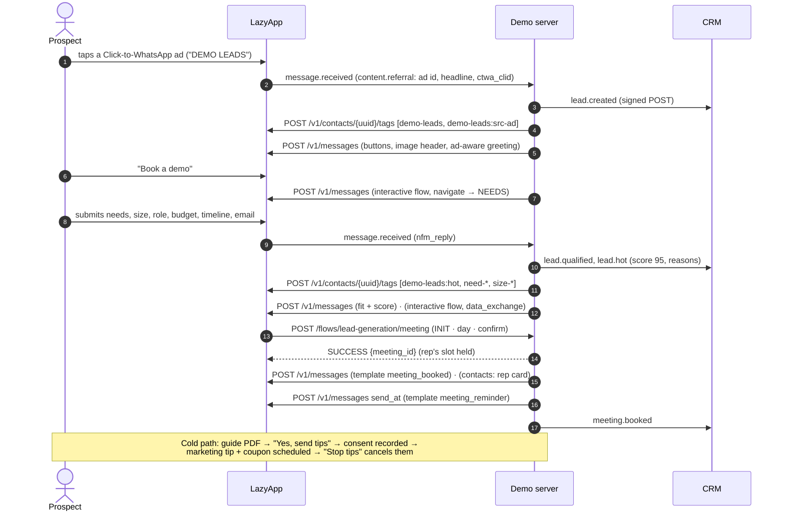

# Ledgerly lead machine: ad to booked demo

An inbound B2B lead machine on WhatsApp. A prospect taps a Click-to-WhatsApp ad (or scans a QR code at an expo, or clicks a website chat link); the first message already knows where they came from. A two-screen Flow qualifies them, a transparent BANT-style score grades them hot, warm or cold, the LazyApp contact is tagged for segments, and the CRM gets a signed webhook for every step. Hot leads land straight on the right rep's calendar; warm ones are offered a demo; cold ones get a useful guide and, only if they tap yes, a two-message nurture drip with a coupon. Opt-outs are honoured from every direction.

Ledgerly is a fictional GST billing SaaS for Indian SMBs.

## Try it

Send **`DEMO LEADS`** (or `/leads`) to the demo number. Variants worth trying:

- `DEMO LEADS src=qr cmp=demo-booth`: QR attribution (this is the QR prefill).
- `DEMO LEADS utm_source=linkedin utm_campaign=gst-week`: website chat link attribution.
- `DEMO LEADS I want a demo of Ledgerly`: straight to qualification (the ice breaker).
- Run a Click-to-WhatsApp ad whose prefilled message is `DEMO LEADS` to see the ad headline in the greeting.

Tap **Book a demo**, answer as a 11–50 person company with a budget above ₹10,000 that wants to switch this month: you will score hot and get the calendar. Answer "just exploring" to see the nurture path; tap **Free GST guide**, then **Yes, send tips**, and the tip arrives in about 3 minutes, the coupon in 10.

## The conversation



## Meta features used

| Feature                              | Where in the flow                                                  | LazyApp API                                                        |
| ------------------------------------ | ------------------------------------------------------------------ | ------------------------------------------------------------------ |
| Click-to-WhatsApp ad referral        | Attribution and a greeting that quotes the ad headline             | `message.received` → `content.referral` (`ctwa_clid`, `source_id`) |
| QR codes and chat links              | `DEMO LEADS src=qr cmp=demo-booth`, `utm_*` tags                   | `POST /v1/connections/{uuid}/qr-codes` (setup)                     |
| WhatsApp Flow, navigate              | Two-screen qualification (checkbox group, dropdowns, email input)  | `interactive.type: flow`, `flow_action: navigate`                  |
| WhatsApp Flow, data exchange         | Demo booking against the rep's live calendar                       | `data_endpoint_uri` → `/flows/lead-generation/meeting`             |
| Reply buttons with image header      | Welcome, routing after scoring, nurture consent                    | `interactive.type: button`                                         |
| List messages                        | Fallback qualification, fallback slots                             | `interactive.type: list`                                           |
| Document                             | GST invoicing guide PDF (served by the demo server)                | `type: document` with `media_url`                                  |
| Contact card                         | Assigned rep after booking                                         | `type: contacts`                                                   |
| Reactions                            | 👍 on "I will join"                                                | `type: reaction`                                                   |
| Utility templates with quick replies | Meeting confirmation and reminder                                  | `type: template`, `components` with `payload`                      |
| Marketing template (text header)     | Nurture tip, only after an explicit "Yes, send tips"               | `POST /v1/messages` `send_at`                                      |
| Marketing template, coupon code      | Re-engagement offer with a copy-code button                        | `template.features.coupon_code`                                    |
| Marketing consent                    | Recorded on tap, withdrawn on "Stop tips" / Stop promotions / STOP | `POST /v1/contacts/{uuid}/consent`                                 |
| Contact tags                         | Grade, size, needs, source, lifecycle                              | `POST` / `DELETE /v1/contacts/{uuid}/tags`                         |
| Events API (optional)                | `appointment.confirmed/rescheduled/cancelled`                      | `POST /v1/events`                                                  |
| `contact.opted_out` webhook          | WhatsApp's native "Stop promotions" cancels the drip               | webhook subscription                                               |
| `message.failed` webhook             | Confirmation template failed later → confirm in-session            | webhook subscription                                               |

## Scoring

| Signal   | Points                                                          |
| -------- | --------------------------------------------------------------- |
| Budget   | under ₹1k 5 · ₹1–3k 15 · ₹3–10k 25 · above ₹10k 30 · not sure 8 |
| Timeline | this month 30 · 1–3 months 20 · 3–6 months 10 · exploring 0     |
| Team     | 1–10 5 · 11–50 15 · 51–200 20 · 201+ 20                         |
| Needs    | 4 per need, up to 12                                            |
| Role     | owner or finance 8 · operations 4                               |

70+ is **hot** (CRM `lead.hot` alert, calendar right away), 45+ **warm** (demo offered), else **cold** (guide first). Each point is kept as a reason (`"budget 10k+ (+30)"`) and sent to the CRM, so sales sees why. Multi-GSTIN or 51+ people routes to the enterprise rep.

## The CRM webhook

Set `LEADS_CRM_WEBHOOK_URL` to anything that accepts a POST: a HubSpot or Salesforce workflow webhook, a Zapier or Make hook, or a Google Apps Script web app that appends a row to a Sheet. Every event is written to an outbox in the demo database first, then delivered:

```http
POST https://crm.example/hooks/leads
content-type: application/json
x-lazyapp-demo-event: lead.hot
x-lazyapp-demo-delivery: crm_3f9a…            (stable per event: dedupe on it)
x-lazyapp-demo-signature: sha256=<HMAC-SHA256(raw body, LEADS_CRM_WEBHOOK_SECRET)>

{ "id": "crm_3f9a…", "type": "lead.hot", "occurred_at": "2026-10-23T03:30:00.000Z",
  "lead": { "id": "LD-1A2B3C4D", "phone": "+9198…", "name": "Asha", "company": "Sharma Traders",
            "email": "asha@sharmatraders.in", "role": "owner", "needs": ["gst-billing", "eway", "recon"],
            "size": "11-50", "budget": "10k+", "timeline": "now", "score": 95, "grade": "hot",
            "reasons": ["budget 10k+ (+30)", "timeline now (+30)", …],
            "attribution": { "channel": "ad", "source": "facebook", "adId": "1202…", "headline": "GST invoices in 2 minutes", "ctwaClid": "ARAk…" },
            "meeting": null, "marketing_opt_in": false } }
```

Event types: `lead.created`, `lead.qualified`, `lead.hot`, `meeting.booked`, `meeting.rescheduled`, `meeting.cancelled`, `nurture.opted_in`, `nurture.opted_out`, `lead.opted_out`. The signature uses the same scheme as LazyApp's own webhooks, so the receiver can reuse `verifyWebhookSignature` from the SDK. A failed delivery stays in the outbox (`status: failed`, `lastError`) and the chat carries on. Without a URL, leads are kept in the outbox (`status: stored`): the "Sheet" of the demo.

`ctwaClid` is what Meta's Conversions API needs to report a qualified lead or a purchase back to the ad (see platform gaps).

## LazyApp API calls

```http
POST /v1/messages   { "to": "+9198…", "type": "interactive", "interactive": { "type": "flow", …,
                      "action": { "name": "flow", "parameters": { "flow_message_version": "3", "flow_id": "<meta id>",
                      "flow_token": "lead-generation.…", "flow_cta": "Start", "flow_action": "navigate",
                      "flow_action_payload": { "screen": "NEEDS" } } } } }
POST /v1/messages   { …, "type": "template", "template": { "name": "demo_lead_generation_meeting_booked", "language": "en",
                      "components": [ { "type": "body", "parameters": [ { "type": "text", "text": "Fri, 23 Oct at 2:00 PM" }, { "type": "text", "text": "Ananya Iyer" } ] },
                                      { "type": "button", "sub_type": "quick_reply", "index": "0", "parameters": [ { "type": "payload", "payload": "meeting:reschedule" } ] }, … ] } }
POST /v1/messages   { …, "type": "template", "send_at": "…", "template": { "name": "demo_lead_generation_comeback_offer", "language": "en",
                      "features": { "coupon_code": "LEDGER30" }, "components": [ { "type": "body", … }, { "type": "button", "sub_type": "quick_reply", "index": "1", … } ] } }
DELETE /v1/messages/scheduled/{id}
POST /v1/contacts/{uuid}/consent  { "granted": true, "channel": "whatsapp", "purpose": "marketing",
                                    "consent_text": "Tapped \"Yes, send tips\" after: …", "captured_by": "lazyapp-examples:lead-generation" }
POST /v1/contacts/{uuid}/tags     { "tags": ["demo-leads:hot", "demo-leads:need-gst-billing", …] }
DELETE /v1/contacts/{uuid}/tags   { "tags": ["demo-leads:meeting-booked"] }
POST /v1/events                   { "type": "appointment.confirmed", "recipient": { "phone_number": "+9198…" }, … }   (LEADS_USE_EVENTS=true)
```

Segments then come for free: `POST /v1/contact-segments` with a `tags` filter on `demo-leads:hot` + `demo-leads:size-51-200` gives sales a list to call; `demo-leads:nurture` is the audience for a broadcast to consented leads.

## Fallbacks

- **Flows not published**: qualification becomes four lists (need, team size, budget, timeline) and booking a list of the rep's next ten open slots; the chat says a fallback is in use.
- **CRM unreachable**: the event stays in the outbox with the error; the lead still gets their demo.
- **Templates not approved**: the confirmation is refused (or fails later as `message.failed`) and goes out as reply buttons inside the 24-hour window. Scheduling failures are logged, not shown.
- **Rep fully booked**: the rep's contact card instead of a calendar.
- **Catalog, payments, address messages**: not used.
- **Session limits**: the reminder and drip are follow-ups that end with the 24-hour session, so the demo compresses them into minutes (`LEADS_TIMING=demo`). In production, run the drip from your CRM or marketing tool on the consent and tags this example records.

## Run it yourself

```bash
npm run setup -- --only lead-generation      # 4 templates, 2 flows, starters, QR
DEMO_EXAMPLES=lead-generation npm run dev
npx vitest run examples/lead-generation
npm run assets -w @lazyapp-examples/example-lead-generation   # rebuild the guide PDF
```

| Variable                   | Default             | Purpose                                                                         |
| -------------------------- | ------------------- | ------------------------------------------------------------------------------- |
| `LEADS_CRM_WEBHOOK_URL`    | (unset: store only) | Where CRM events are POSTed                                                     |
| `LEADS_CRM_WEBHOOK_SECRET` | (unset: unsigned)   | HMAC secret for `x-lazyapp-demo-signature`                                      |
| `LEADS_TIMING`             | `demo`              | `demo` (reminder +2 min, drip +3/+10 min) or `production` (−15 min, +2/+5 days) |
| `LEADS_USE_EVENTS`         | `false`             | Confirm meetings through `POST /v1/events` (needs an event mapping)             |
| `LEADS_REP_PHONE`          | `DEMO_PHONE_NUMBER` | Number on the rep's contact card; keep it the demo number                       |

## Code tour

| File                 | What it shows                                                                  |
| -------------------- | ------------------------------------------------------------------------------ |
| `src/index.ts`       | `createLeadGenerationExample(config)`, routing, `onEvent`, `onEnd` for STOP    |
| `src/attribution.ts` | Ad referral and `utm_*`/`src=` parsing                                         |
| `src/qualify.ts`     | Qualification Flow, list fallback, scoring and routing by grade                |
| `src/scoring.ts`     | Score with reasons, plan recommendation, rep routing, segmentation tags        |
| `src/meeting.ts`     | Booking, confirmation (template / events / in-session), reminder, move, cancel |
| `src/endpoints.ts`   | Meeting Flow data endpoint                                                     |
| `src/schedule.ts`    | Weekday IST calendar and the one-lead-per-rep slot ledger                      |
| `src/nurture.ts`     | Guide, consent, marketing drip with coupon, every opt-out path                 |
| `src/crm.ts`         | Outbox, signed webhook delivery, tags, events                                  |
| `src/assets.ts`      | The guide PDF, rendered with the demo kit's `renderPdf`                        |
