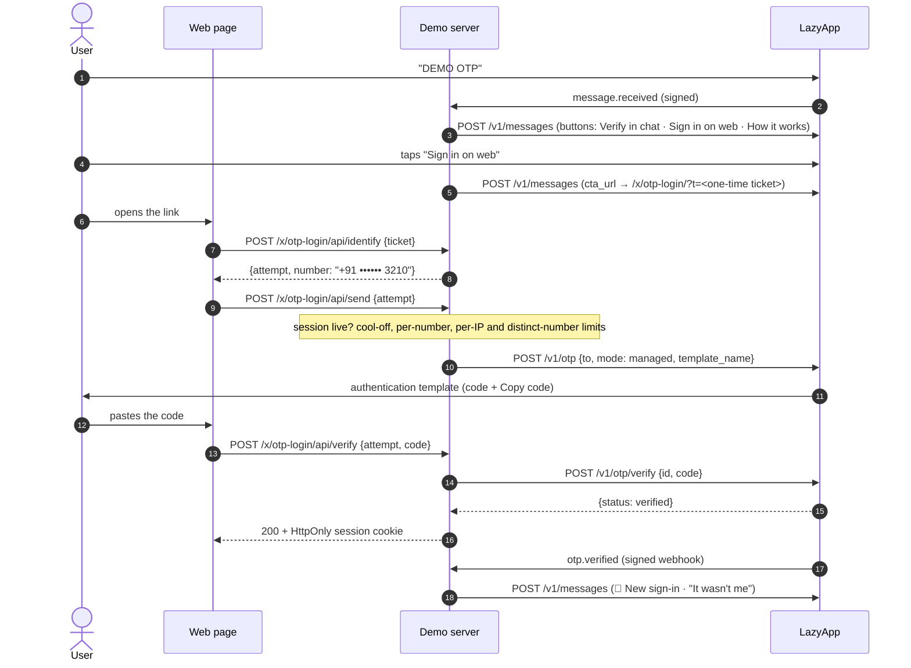

# Login with WhatsApp (OTP)

Sign people in with a one-time code on WhatsApp instead of SMS: cheaper in India, delivered to an app people already have open, and phishing-resistant thanks to Meta's authentication templates. This demo shows the whole thing end to end on LazyApp's **managed OTP** (`POST /v1/otp` + `POST /v1/otp/verify`): verifying inside the chat, a real web sign-in page served by the demo server, the `otp.verified` / `otp.failed` webhooks turned into "new sign-in" and "wrong code" alerts, and the guards a production login needs (cool-offs, per-number and per-IP limits, lock-outs, expiry).

## Try it

1. Send **`DEMO OTP`** (or `/otp`) to the demo number.
2. **Verify in chat**: a code arrives as an authentication template with a _Copy code_ button. Paste it back. Try a wrong code, an old code, or _Send a new code_ straight away to see the guards.
3. **Sign in on web**: tap _Open login page_, then _Send code on WhatsApp_, and enter the code. The chat gets a 🔔 _New sign-in_ alert; _It wasn't me_ signs that web session out.

## The conversation



## Meta features used

| Feature                             | Where                                                  | LazyApp API                                                 |
| ----------------------------------- | ------------------------------------------------------ | ----------------------------------------------------------- |
| Authentication template (copy code) | Every code, chat and web                               | `POST /v1/templates/authentication` (setup), `POST /v1/otp` |
| One-tap autofill (Android)          | Optional second template when an app is configured     | `POST /v1/templates/authentication` `otp_type: ONE_TAP`     |
| Code expiry + time-to-live          | Template `code_expiration_minutes: 10`, TTL 600s       | `POST /v1/templates/authentication`                         |
| Reply buttons                       | Menu, resend, sign-in alert                            | `POST /v1/messages` `interactive.type: button`              |
| CTA URL button                      | "Open login page" with a one-time ticket               | `interactive.type: cta_url`                                 |
| Reactions                           | ✅ on a correct code, ❌ on a wrong one                | `type: reaction`                                            |
| Read receipts + typing              | While a code is sent or checked                        | `POST /v1/messages/{uuid}/read` `{typing: true}`            |
| Webhooks                            | `otp.verified` → sign-in alert, `otp.failed` → warning | `POST /v1/webhooks` (setup)                                 |
| Conversation starter command        | `/otp`                                                 | `PUT /v1/connections/{uuid}/conversation-starters`          |

## LazyApp API calls

```http
POST /v1/otp
Idempotency-Key: <event id>:otp-login:otp-send        # web: otp-login:web:<attempt>:<n>
{ "to": "+919876543210", "mode": "managed", "template_name": "demo_otp_login_code" }
→ 201 { "id": "<challenge uuid>", "status": "pending", "expires_at": "…", "mode": "managed" }

POST /v1/otp/verify
{ "id": "<challenge uuid>", "code": "482913" }
→ 200 { "id": "…", "status": "verified", "verified_at": "…" }
→ 422 { "message": "Invalid OTP code." | "OTP has expired." | "Too many OTP attempts." | "No pending OTP challenge found." }

POST /v1/templates/authentication     (npm run setup)
{ "name": "demo_otp_login_code", "languages": ["en_US"], "otp_type": "COPY_CODE",
  "add_security_recommendation": true, "code_expiration_minutes": 10, "message_send_ttl_seconds": 600 }
```

Verification is always **by challenge id**, never by phone number, so an older code can never satisfy a newer challenge.

## The web page

`GET /x/otp-login/` is one self-contained HTML document (no build, no external assets, light and dark, `autocomplete="one-time-code"`). Its JSON API:

| Route                              | Does                                                                                                    |
| ---------------------------------- | ------------------------------------------------------------------------------------------------------- |
| `POST /api/identify`               | `{ticket}` from the chat link, or `{phone}` typed in. Answers a masked number and an opaque attempt id. |
| `POST /api/send`                   | Sends a code for the attempt. `429` + `Retry-After` on cool-offs and limits.                            |
| `POST /api/verify`                 | Checks the code. On success sets an `HttpOnly; Secure; SameSite=Lax` session cookie.                    |
| `GET /api/me`, `POST /api/signout` | Session status, sign out.                                                                               |

Security choices worth copying:

- **The page only sends codes to numbers in a live `DEMO OTP` chat.** On a shared number that keeps the demo from ever messaging a stranger; in a real product the same check ("this number has talked to us") is a strong defence against SMS-pumping-style fraud.
- The chat link carries a random 144-bit ticket, not the phone number, and the page removes it from the address bar on load. Responses are `no-store` and `Referrer-Policy: no-referrer`.
- POSTs must be `application/json`, so a cross-site form cannot drive the API. A strict CSP and `frame-ancestors 'none'` stop framing.
- The client IP is taken from the last `X-Forwarded-For` hop (the one nginx adds), never the first.

## Guards

| Guard                   | Demo                                                   | LazyApp (server side)                   |
| ----------------------- | ------------------------------------------------------ | --------------------------------------- |
| Resend cool-off         | 30 s per number                                        | 30 s (`OTP_RESEND_DELAY_SECONDS`)       |
| Codes per number        | 5 / hour, 3 per chat session                           | 20 / day                                |
| Codes per IP            | 10 / hour                                              | —                                       |
| Distinct numbers per IP | 3 / hour                                               | 10 / hour (API caller's IP)             |
| Wrong codes             | 3 in chat → 15 min pause; 5 per number per hour → lock | 5 per challenge, 10 per number per hour |
| Expiry                  | 10 minutes, single use                                 | 10 minutes, single use                  |

## SMS fallback

WhatsApp is not everyone's channel. A production login should fall back to SMS when:

- `POST /v1/otp` refuses because the number is not on WhatsApp, or the `message.failed` webhook for the OTP message arrives with Meta error `131026` (undeliverable) within a few seconds;
- the person taps "Didn't get it? Send by SMS" after the cool-off.

Use `mode: "delivery_only"` when you want **one code on both channels**: generate the code yourself, send it with `POST /v1/otp {mode: "delivery_only", code}` and through your SMS provider (with a DLT-registered template in India), and verify it yourself. With `managed` mode, LazyApp holds the code, so an SMS fallback has to issue a separate code and your verify step must accept either. Keep the same cool-offs and lock-outs across both channels, or attackers will pick the weaker one.

## Android one-tap autofill

Set `OTP_LOGIN_ANDROID_PACKAGE` and `OTP_LOGIN_ANDROID_SIGNATURE_HASH` (the 11-character app hash from Google's SMS Retriever tooling) and `npm run setup` also creates `demo_otp_login_one_tap` (`otp_type: ONE_TAP`); codes are then sent with it. Your app must start the handshake (`com.whatsapp.otp.OTP_REQUESTED` broadcast) before the code is requested; on devices without the app, WhatsApp shows a copy-code button instead.

## Fallbacks

- **No phone number** (username-only WhatsApp accounts): the demo explains that a code needs a number, as a real app would ask for one.
- **Template not approved yet**: `POST /v1/otp` fails and the chat says the code service is busy; nothing is retried blindly.
- **Webhooks not subscribed**: sign-in still works; only the chat alerts are missing.

## Platform gaps found

| Endpoint                         | Problem                                                                                                                                                                                                                    | Suggested fix                                                                                                                                                          |
| -------------------------------- | -------------------------------------------------------------------------------------------------------------------------------------------------------------------------------------------------------------------------- | ---------------------------------------------------------------------------------------------------------------------------------------------------------------------- |
| `POST /v1/otp`                   | The fan-out fraud rule (10 distinct numbers per IP per hour) uses the **API caller's** IP. Every server-side integration sends from one IP, so a website can only send codes to 10 different people an hour.               | Accept an optional `client_ip` for the rule, and skip it when it is absent.                                                                                            |
| `POST /v1/otp`, `/v1/otp/verify` | `throttle:otp` allows 5 requests per minute per API key, shared by send **and** verify. A login page with more than ~2 sign-ins a minute is throttled.                                                                     | Separate, higher per-key limits; rely on the per-recipient rules for abuse.                                                                                            |
| `POST /v1/otp`, `/v1/otp/verify` | Refusals are `422 { message }` with no `code`, so callers must match English text (this example does, in `src/otp.ts`). The cool-off is a 422, not a 429 with `Retry-After`.                                               | Add codes (`otp_resend_too_soon`, `otp_daily_limit`, `otp_invalid`, `otp_expired`, `otp_locked`, `otp_not_found`) and answer the cool-off as `429` with `Retry-After`. |
| `POST /v1/otp`                   | The template language comes from a global setting (`OTP_TEMPLATE_LANGUAGE`, default `en_US`); there is no `language` parameter. A workspace whose authentication template is `en` or `hi` gets Meta error 132001.          | Accept `language`, defaulting to the template's only language.                                                                                                         |
| `POST /v1/otp`                   | Without `template_name` (and no workspace default), managed mode sends the code as free-form text with the service-window check disabled. Outside 24h Meta rejects it, and codes must use authentication templates anyway. | Require an authentication template, and refuse with a code when none is configured.                                                                                    |

## Run it yourself

```bash
npm run setup -- --only otp-login          # creates demo_otp_login_code and subscribes otp.* webhooks
DEMO_EXAMPLES=otp-login npm run dev
open http://localhost:8787/x/otp-login/    # the sign-in page
npx vitest run examples/otp-login
```

| Variable                           | Required | Notes                                              |
| ---------------------------------- | -------- | -------------------------------------------------- |
| `OTP_LOGIN_ANDROID_PACKAGE`        |          | Enables the one-tap template (with the hash below) |
| `OTP_LOGIN_ANDROID_SIGNATURE_HASH` |          | 11-character app signing hash                      |

The API key needs `messages:send` (send) and `messages:read` (verify), plus `templates:write` for setup.
