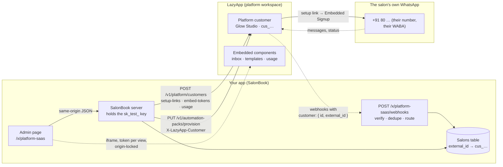

# Build your own WhatsApp SaaS (SalonBook)

For SaaS founders and the people who fund them: how a vertical SaaS puts WhatsApp inside its product for **every one of its customers**, each on their own number, without building a Meta integration per customer. The example has two halves:

- **SalonBook**, a fictional salon-booking SaaS with a small admin web app. It onboards salons as LazyApp **platform customers**, hands each one a **setup link** (Meta Embedded Signup), embeds LazyApp's **inbox, templates and usage** components with short-lived, origin-locked tokens, reads **per-salon usage**, provisions an **automation pack** for a salon, and receives **webhooks routed by the customer envelope**. It runs against LazyApp **test mode** with an `sk_test_` key.
- A **guided WhatsApp chat** (`DEMO PLATFORM` on the shared demo number) that explains the platform model in five steps and links to SalonBook. It informs; it doesn't sell. A "Book a call" hand-off is there for anyone who wants one.

## Try it

Send **`DEMO PLATFORM`** (or `/platform`) to the demo number, then:

1. **Start the tour** → _Next: connecting_ → _Next: embedding_ → pick **Inbox** from the list → _Next: webhooks_ → _Next: try it_.
2. Tap **Open SalonBook**, pick _Glow Studio_ and go top to bottom: **Create in LazyApp** → **Create setup link** (URL and QR) → **Inbox / Templates / Usage** embeds → **Refresh usage** → **Simulate** `customer.connected` → **Provision real_estate**.
3. Back in WhatsApp: **What works today?**, then **Book a call**.

## The platform model



## The conversation

```mermaid
sequenceDiagram
  autonumber
  actor U as Visitor
  participant L as LazyApp
  participant S as Demo server
  U->>L: "DEMO PLATFORM"
  L->>S: message.received
  S->>L: POST /v1/messages (buttons: Start the tour · Open the web demo · Book a call)
  U->>L: Start the tour → Next → Next
  S->>L: POST /v1/messages (1/5 customers, 2/5 setup links: buttons)
  S->>L: POST /v1/messages (3/5 list: inbox · templates · usage · connection · messages)
  U->>L: picks "Inbox", then Next
  S->>L: POST /v1/messages (4/5 webhooks: buttons)
  U->>L: Next: try it
  S->>L: POST /v1/messages (cta_url "Open SalonBook") + buttons
  U->>L: Book a call → "Tomorrow morning"
  S->>L: POST /v1/contacts/{uuid}/tags ["platform-saas:call-requested"]
  S->>L: POST /v1/messages ("Noted… someone replies in this chat")
```



## Meta features used

| Feature                      | Where                                                        | LazyApp API                                        |
| ---------------------------- | ------------------------------------------------------------ | -------------------------------------------------- |
| Reply buttons                | Every tour step, "What works today?", call confirmation      | `POST /v1/messages` `interactive.type: button`     |
| List message                 | Step 3 (embeddable components), call time picker             | `interactive.type: list`                           |
| CTA URL button               | "Open SalonBook", "Book a call" (when a booking URL is set)  | `interactive.type: cta_url`                        |
| Typing indicator             | Every message (router)                                       | `POST /v1/messages/{uuid}/read`                    |
| Contact tags                 | Call requests show up in the LazyApp console                 | `POST /v1/contacts/{uuid}/tags`                    |
| Conversation starter command | `/platform`                                                  | `PUT /v1/connections/{uuid}/conversation-starters` |
| Embedded Signup              | Setup links SalonBook hands each salon                       | `POST /v1/platform/setup-links`                    |
| Multi-tenant WhatsApp        | One workspace and number per salon, one key and one endpoint | Platform API (below)                               |

## LazyApp API calls

All platform calls use SalonBook's **own** key (`PLATFORM_SAAS_API_KEY`, `sk_test_…`), never the demo number's key.

```http
GET  /v1/platform/customers?external_id=salonbook-demo-glow-studio-20261023&limit=1
POST /v1/platform/customers                      Idempotency-Key: salonbook:customer:<external_id>
{ "name": "Glow Studio", "external_id": "salonbook-demo-glow-studio-20261023", "billing_mode": "inherit",
  "usage_alert_cents": 5000, "metadata": { "app": "salonbook-demo", "area": "Indiranagar, Bengaluru", "stylists": 6 } }

POST /v1/platform/setup-links
{ "customer_id": "cus_…", "expires_in_days": 1, "use_policy": "single", "allowed_connection_type": "new",
  "redirect_url": "https://demo.lazyapp.in/x/platform-saas/?connected=1", "locale": "en" }
→ { "id": "set_…", "url": "https://lazyapp.in/connect/…", … }      (url shown once, never logged or stored)

POST /v1/platform/embed-tokens                   (one per component view)
{ "customer_id": "cus_…", "component": "inbox", "expires_in_minutes": 10,
  "origin_allowlist": ["https://demo.lazyapp.in"], "locale": "en" }

GET  /v1/platform/customers/{cus_…}/usage?period=2026-10           (cached 60 s in SalonBook)

PUT  /v1/automation-packs/provision              X-LazyApp-Customer: salonbook-demo-glow-studio-20261023
{ "pack": "real_estate" }

DELETE /v1/platform/customers/{cus_…}            (daily reset of yesterday's seed salons, test mode only)

POST /v1/webhooks                                (npm run provision-webhook, once)
{ "url": "https://demo.lazyapp.in/x/platform-saas/webhooks", "subscribed_events": ["customer.connected",
  "customer.usage_alert", "setup_link.failed", "connection.attention_required", "connection.disconnected", "message.received"] }
```

Chat side (demo key): `POST /v1/messages`, `POST /v1/messages/{uuid}/read`, `POST /v1/contacts/{uuid}/tags`.

### Webhooks SalonBook handles

| Event                                                      | SalonBook does                                                   |
| ---------------------------------------------------------- | ---------------------------------------------------------------- |
| `customer.connected`                                       | Marks the salon connected and stores the display number          |
| `setup_link.failed`                                        | Shows the reason and offers a fresh link                         |
| `customer.usage_alert`                                     | Flags the salon's usage card                                     |
| `connection.attention_required`, `connection.disconnected` | Marks the salon "needs attention" (reconnect link)               |
| `message.received`                                         | Logs `Inbound text from +91******5670`; the body is never stored |

Every delivery is verified (`X-LazyApp-Signature`, HMAC over the raw body), test pings are dropped, redeliveries are de-duplicated by event id, and the salon is found by `customer.external_id` (or `customer.id`). Deliveries without a customer envelope, or for a customer SalonBook doesn't know, are acknowledged and ignored.

## Test mode vs live

| Works today with `sk_test_`                                                                                                             | Needs live Embedded Signup (LazyApp's Meta app review)          |
| --------------------------------------------------------------------------------------------------------------------------------------- | --------------------------------------------------------------- |
| Creating customers with your `external_id`                                                                                              | A salon finishing Embedded Signup and connecting its own number |
| Setup links (URL and QR)                                                                                                                | Real `customer.connected` / `setup_link.failed` deliveries      |
| Embed tokens and iframes (see the gap below about their data)                                                                           | Messages to and from the salon's own number                     |
| Per-salon usage, automation packs, `X-LazyApp-Customer`                                                                                 | `message.received` for the salon's clients                      |
| Webhook verification and routing (plus the **Simulate** buttons, which feed sample events with the real envelope through the same code) |                                                                 |

## Security

- **API keys stay server-side.** The admin page only calls SalonBook's `/x/platform-saas/api/*`; the key lives in the server's environment. The default key must be `sk_test_` (`PLATFORM_SAAS_ALLOW_LIVE=true` to override), and it is a separate key from the demo number's.
- **Embed tokens** are minted per view, 10 minutes, one component, one salon, `origin_allowlist` = SalonBook's origin. The embed URL must be on LazyApp's origin or SalonBook refuses it; the page's CSP allows framing LazyApp only (`frame-src`), and the iframe sends `Referer` with `referrerpolicy="strict-origin"` because LazyApp checks the allowlist against `Origin`/`Referer` and the demo pages otherwise send no referrer.
- **Setup-link URLs** are returned to the page once. Only the link id goes to logs and storage; tests assert the token never appears in either.
- **Rate limits** (`src/guard.ts`): 120 reads, 20 writes and 30 embeds per IP per 10 minutes, 300 writes per hour across everyone, 5 setup links per salon per day. Writes must be same-origin (`Origin` check), so another site cannot drive the admin.
- **No real customer data.** Only the three seed salons exist; visitors can't type names or numbers. Inbound messages are logged as type plus masked number. Everything resets at midnight IST: yesterday's customers are deleted from the test workspace and SalonBook's records wiped (customers use day-stamped `external_id`s, so days never mix).
- **The shared number stays safe.** The demo router now ignores any event that carries a `customer` envelope, so a salon's client can never trigger a demo reply from the shared number, even if both webhooks point at the same workspace.

## Fallbacks

- **No platform key**: the admin page explains what to set; every API route answers `503` and LazyApp is never called.
- **No `PLATFORM_SAAS_WEBHOOK_SECRET`**: the webhook route answers `503`; Simulate still works.
- **No `PLATFORM_SAAS_BOOK_CALL_URL`**: "Book a call" asks for a preferred time in a list and tags the contact `platform-saas:call-requested` for the LazyApp team; with one set it's a single CTA button.
- **Contact tags unavailable**: logged and skipped; the person still gets the confirmation.

## Platform gaps found

| Endpoint                                                                                               | Problem                                                                                                                                                                                                                                                                                                                      | Suggested fix                                                                                                                                                      |
| ------------------------------------------------------------------------------------------------------ | ---------------------------------------------------------------------------------------------------------------------------------------------------------------------------------------------------------------------------------------------------------------------------------------------------------------------------- | ------------------------------------------------------------------------------------------------------------------------------------------------------------------ |
| `GET /embed/{token}` (`PlatformEmbedController::show`)                                                 | Always renders **live-mode** data (`$mode = WorkspaceMode::Live`), even for tokens minted with an `sk_test_` key. A test-mode customer's embeds look empty.                                                                                                                                                                  | Store the mode on the embed token at creation and render with it.                                                                                                  |
| Setup link completion (`PlatformConnectController::store`)                                             | Always completes in live mode, and there is no test-mode way to finish Embedded Signup, so test-mode endpoints never receive `customer.connected`.                                                                                                                                                                           | A test-mode "simulate connect" (e.g. `POST /v1/platform/setup-links/{id}/simulate` with `sk_test_`) that creates a test connection and fires `customer.connected`. |
| `GET /v1/platform/customers/{customer}/usage`                                                          | OpenAPI documents `{ data: { period, messages, total_charge } }`; LazyApp returns the analytics object (`totals`, `byCategory`, `daily`…, `billing_mode`, `wallet_balance_cents`). The `period` query parameter is not in the schema. The docs' `wholesale_total` / `marked_up_total` / `markup_bps` are no longer returned. | Publish the real response schema and `period`; drop the markup fields from `platform/usage.mdx` and `platform/overview.mdx`.                                       |
| `GET /v1/platform/customers`, `GET /v1/platform/setup-links`                                           | OpenAPI documents `page` and `meta`; the API is cursor paginated (`limit`, `cursor`, `next_cursor`) and filters by `external_id` / `customer_id`, which are undocumented.                                                                                                                                                    | Update the OpenAPI parameters and response envelope.                                                                                                               |
| `POST /v1/platform/customers`, `PATCH …`                                                               | `markup_bps`, `pricing_mode`, `category_markups`, `platform_fee` are still documented (and in the OpenAPI response) but ignored and never returned.                                                                                                                                                                          | Mark them deprecated in OpenAPI and the overview page.                                                                                                             |
| `POST /v1/platform/setup-links`, `POST /v1/platform/embed-tokens`, `/v1/platform/customers/{customer}` | Accept only the `cus_…` public id. The overview says "keep using your own external_id — LazyApp accepts either", which is only true for `X-LazyApp-Customer`.                                                                                                                                                                | Resolve `customer_id` / `{customer}` by `external_id` too, or correct the docs.                                                                                    |
| `POST /v1/platform/embed-tokens`                                                                       | Docs show `url` as `/embed/inbox?token=…`; LazyApp returns `/embed/{token}`. An empty `origin_allowlist` silently falls back to the platform's branding origins, and with no origins at all a token renders anywhere.                                                                                                        | Fix the docs; consider requiring at least one origin.                                                                                                              |
| `PUT /v1/automation-packs/provision`                                                                   | Only `real_estate` exists (`config/event_packs.php`, `workflow_packs.php`, `template_sets.php`), so a salon gets property-visit templates.                                                                                                                                                                                   | Ship an `appointments` / `salon` pack (booking confirmed, reminder, no-show, review request) and a matching template set.                                          |
| Webhook docs (`webhooks/events`)                                                                       | The `data` payloads of `customer.connected`, `customer.usage_alert` and `setup_link.failed` are not documented (the overview shows `"data": { }`), so SalonBook reads them defensively.                                                                                                                                      | Document each payload (connection, threshold and spend, failure reason).                                                                                           |

## Run it yourself

```bash
# .env (see .env.example)
PLATFORM_SAAS_API_KEY=sk_test_…          # key on a platform-enabled workspace: customers:write, templates:write, webhooks:write
PLATFORM_SAAS_WEBHOOK_SECRET=            # printed by the next command
PLATFORM_SAAS_BOOK_CALL_URL=             # optional https scheduling link
PLATFORM_SAAS_AUTOMATION_PACK=real_estate

npm run provision-webhook -w @lazyapp-examples/example-platform-saas   # creates the platform webhook endpoint
DEMO_EXAMPLES=platform-saas npm run dev
open http://localhost:8787/x/platform-saas/
npx vitest run examples/platform-saas
```

- The workspace behind `PLATFORM_SAAS_API_KEY` must be a **platform workspace** (LazyApp → Platform). Otherwise every platform call answers `403 This API key is not a platform key`.
- The chat needs nothing from `npm run setup` beyond the `/platform` command; it has no templates or flows. The demo server's own key needs `messages:send` and `messages:read` (tags).
- Embedded components only render on the origin in `PUBLIC_BASE_URL` (the token's allowlist). Locally that is `http://localhost:8787`, which LazyApp accepts as an allowlisted origin.
