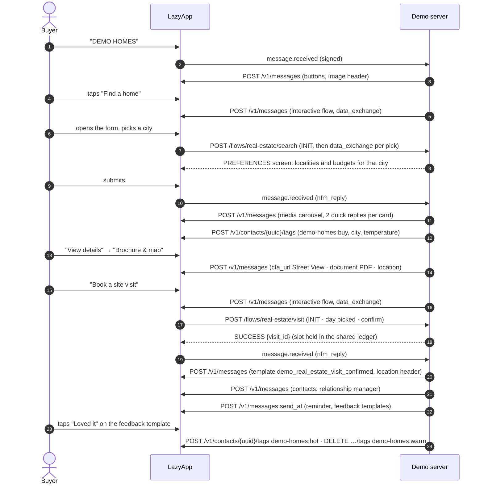

# Brickfield Homes: search to site visit

A property developer's sales funnel, end to end in WhatsApp. A buyer sets their preferences in a native form, swipes through matching homes, saves a shortlist, downloads a brochure, works out their EMI and books a site visit against live slot availability. The booking comes back as a confirmation with the project's pin, the city's relationship manager arrives as a contact card, a reminder and a feedback request follow, and every action moves a lead score that tags the contact for the sales team.

Brickfield Homes is fictional; the localities, coordinates and price levels are real enough to feel like a working property app.

## Try it

Send **`DEMO HOMES`** (or `/homes`) to the demo number, or put your search straight after the code:

- `DEMO HOMES 2 BHK to rent in Pune` searches immediately (this is also the ice breaker).
- **Find a home** opens the preferences Flow. Pick Bengaluru, any budget, 2 and 3 BHK.
- Swipe the carousel, tap **View details**, then **Brochure & map**, **EMI for this home** and **Book a site visit**.
- After booking, the reminder arrives in about 2 minutes and the feedback request about 5 minutes later (demo timing). Tap **Loved it** and watch the lead turn hot.
- Typed searches work too: `3 bhk baner`, `4bhk villa hyderabad`, `homes near me` via **Homes near me**.

## The conversation



## Meta features used

| Feature                                     | Where in the flow                                               | LazyApp API                                                                    |
| ------------------------------------------- | --------------------------------------------------------------- | ------------------------------------------------------------------------------ |
| WhatsApp Flow, data exchange                | Preferences (localities and budgets reload as the city changes) | `POST /v1/flows` (`data_endpoint_uri`), `interactive.type: flow`               |
| WhatsApp Flow, data exchange                | EMI calculator (endpoint does the maths, RESULT screen)         | same                                                                           |
| WhatsApp Flow, data exchange                | Site-visit booking with live slots, `SUCCESS` closes the flow   | same                                                                           |
| Media carousel with quick replies           | Search results, homes near me, alternatives after feedback      | `interactive.type: carousel`                                                   |
| CTA URL button with image header            | Listing details → Google Street View                            | `interactive.type: cta_url`                                                    |
| Reply buttons with image header             | Welcome, single result                                          | `interactive.type: button`                                                     |
| List messages                               | Menu, shortlist, visits, fallback questions and slots           | `interactive.type: list`                                                       |
| Document                                    | Brochure PDF (served by the demo server)                        | `type: document` with `media_url`                                              |
| Location + location request                 | Project pin, directions; "Homes near me"                        | `type: location`, `interactive.type: location_request_message`                 |
| Contact card                                | Relationship manager after booking and on "Talk to an advisor"  | `type: contacts`                                                               |
| Reactions                                   | ❤️ on shortlist, 🎉 on "Loved it"                               | `type: reaction`                                                               |
| Read receipts + typing                      | Every inbound message (router)                                  | `POST /v1/messages/{uuid}/read` `{ typing: true }`                             |
| Utility template with location header       | Visit confirmation with the project pin, quick-reply payloads   | `POST /v1/templates`, `type: template` with `features.location` + `components` |
| Scheduled utility templates                 | Visit reminder and post-visit feedback                          | `POST /v1/messages` with `send_at`, `DELETE /v1/messages/scheduled/{id}`       |
| Contact tags                                | Lead score temperature, purpose, city, visit booked             | `POST` / `DELETE /v1/contacts/{uuid}/tags`                                     |
| Events API (optional)                       | `appointment.confirmed/rescheduled/cancelled`                   | `POST /v1/events`                                                              |
| Conversation starters, QR code, ice breaker | `/homes`, `DEMO HOMES` QR, `DEMO HOMES Find me a 2 BHK…`        | `PUT /v1/connections/{uuid}/conversation-starters`, `POST …/qr-codes`          |
| `message.failed` webhook                    | Confirmation template rejected later → confirm in-session       | webhook subscription                                                           |

## LazyApp API calls

Every write carries a deterministic `Idempotency-Key` derived from the inbound event, so a redelivered webhook never double-sends.

```http
POST /v1/messages
{ "to": "+9198…", "type": "interactive", "interactive": { "type": "carousel", "body": { "text": "3 homes to buy in Bengaluru…" },
  "action": { "cards": [ { "card_index": 0, "type": "cta_url", "header": { "type": "image", "image": { "link": "https://images.unsplash.com/…" } },
    "body": { "text": "*Brickfield Aurora*\nWhitefield · 2 BHK · 1,150 sq ft · ₹92 L\nReady to move" },
    "action": { "buttons": [ { "type": "quick_reply", "quick_reply": { "id": "home:view:blr-aurora", "title": "View details" } }, … ] } }, … ] } },
  "metadata": { "demo": "real-estate", "session": "…" } }

POST /v1/messages
{ "to": "+9198…", "type": "template", "template": {
    "name": "demo_real_estate_visit_confirmed", "language": "en",
    "features": { "location": { "latitude": "12.9698", "longitude": "77.75", "name": "Brickfield Aurora sales gallery", "address": "…" } },
    "components": [
      { "type": "body", "parameters": [ { "type": "text", "text": "Brickfield Aurora, Whitefield" }, { "type": "text", "text": "Fri, 23 Oct at 3:00 PM" }, { "type": "text", "text": "Priya Nair" } ] },
      { "type": "button", "sub_type": "quick_reply", "index": "0", "parameters": [ { "type": "payload", "payload": "visit:reschedule:V-7KQ2M9" } ] },
      { "type": "button", "sub_type": "quick_reply", "index": "1", "parameters": [ { "type": "payload", "payload": "visit:cancel:V-7KQ2M9" } ] } ] } }

POST /v1/messages            { …, "type": "template", "template": { "name": "demo_real_estate_visit_reminder", … }, "send_at": "…" }   → 202 { "id": "sch_…" }
DELETE /v1/messages/scheduled/{id}                                   (reschedule, cancel, EXIT, STOP, session expiry)
POST /v1/contacts/{uuid}/tags   { "tags": ["demo-homes:hot"] }
DELETE /v1/contacts/{uuid}/tags { "tags": ["demo-homes:warm"] }
POST /v1/events               { "type": "appointment.confirmed", "recipient": { "phone_number": "+9198…" },
                                "properties": { "project": "…", "when": "…", "agent": "…", "visit_id": "V-7KQ2M9" },
                                "idempotency_key": "demo-homes-V-7KQ2M9-2026-10-23T09:30:00.000Z" }    (only with REAL_ESTATE_USE_EVENTS=true)
GET  /v1/flows                (cached: Meta flow ids for demo_real_estate_search / _emi / _visit)
POST /v1/messages/{uuid}/read { "typing": true }
```

Flow data endpoint (LazyApp decrypts Meta's request and forwards it, signed, to `${PUBLIC_BASE_URL}/flows/real-estate/<key>`):

| Flow     | `INIT`                                          | `data_exchange`                                                                                    |
| -------- | ----------------------------------------------- | -------------------------------------------------------------------------------------------------- |
| `search` | Purposes, cities, localities, budgets, bedrooms | `trigger: purpose / city` → the same screen with that city's localities and that purpose's budgets |
| `emi`    | Loan prefilled at 80% of the home in focus      | Validates the amount (error snackbar), returns the `RESULT` screen                                 |
| `visit`  | Open days for the home in focus                 | `trigger: day` → open slots; `trigger: confirm` → holds the slot, `SUCCESS` with the visit id      |

## Lead scoring

| Signal                         | Points       |
| ------------------------------ | ------------ |
| Searched                       | 10           |
| Shortlisted (5 each, up to 15) | 15           |
| Downloaded a brochure          | 5            |
| Ran the EMI calculator         | 15           |
| Asked for an advisor           | 15           |
| Booked a site visit            | 30           |
| Loved the visit / okay / no    | 30 / 5 / −10 |

60+ is `demo-homes:hot`, 30+ `demo-homes:warm`, else `cold`. Tags are diffed, so a contact only ever carries one temperature. Build a segment on `demo-homes:hot` + `demo-homes:city-bengaluru` and broadcast launch offers to it (with marketing consent).

## Fallbacks

- **Flows not published**: the search becomes Buy/Rent buttons → city list → budget list; the EMI answers in the chat (three tenures, type `60 lakh` to recalculate); the visit becomes a list of the next ten open slots. Each fallback says so in the chat.
- **Confirmation template not approved**: the send is refused (or fails later as `message.failed`), and the same confirmation goes out as a location pin plus reply buttons while the 24-hour window is open.
- **No mapping for the event** (events mode): `POST /v1/events` returns 422 and the template is sent directly.
- **Catalog, payments, address messages**: not used. Property is sold by visit, not by cart.
- **Session limits**: reminders and feedback are scheduled follow-ups and end with the 24-hour session, so the demo compresses them into minutes (`REAL_ESTATE_REMINDERS=demo`). In production, schedule them from your CRM (or keep sessions longer) and use `REAL_ESTATE_REMINDERS=production` timing: 3 hours before and 2 hours after the visit.

## Run it yourself

```bash
npm run setup -- --only real-estate          # 3 templates, 3 flows with data endpoints, starters, QR
DEMO_EXAMPLES=real-estate npm run dev
npx vitest run examples/real-estate
npm run assets -w @lazyapp-examples/example-real-estate   # rebuild the brochure PDFs after editing listings
```

| Variable                  | Default             | Purpose                                                                                      |
| ------------------------- | ------------------- | -------------------------------------------------------------------------------------------- |
| `REAL_ESTATE_AGENT_PHONE` | `DEMO_PHONE_NUMBER` | Number on the agent contact card. Keep it the demo number so "Message" returns to this chat. |
| `REAL_ESTATE_REMINDERS`   | `demo`              | `demo` (2 and 7 minutes after booking) or `production` (3 h before, 2 h after the visit).    |
| `REAL_ESTATE_USE_EVENTS`  | `false`             | Confirm visits through `POST /v1/events` instead of sending the template.                    |

For events mode, map the event types to the templates once:

```bash
curl -X PUT https://lazyapp.in/v1/event-mappings/provision \
  -H "Authorization: Bearer $LAZYAPP_API_KEY" -H "Content-Type: application/json" \
  -d '{ "mappings": [ { "event_type": "appointment.confirmed", "template_name": "demo_real_estate_visit_confirmed",
        "language": "en", "body_variables": ["project", "when", "agent"], "pricing_category": "utility" } ] }'
```

Mappings are workspace-wide, so do this only in a workspace where nothing else sends `appointment.confirmed`.

## Code tour

| File               | What it shows                                                                                          |
| ------------------ | ------------------------------------------------------------------------------------------------------ |
| `src/index.ts`     | `createRealEstateExample(config)`: routing by `inbound.kind` and id prefix                             |
| `src/listings.ts`  | Inventory, search with honest relaxation, free-text parsing, distance, price formatting                |
| `src/search.ts`    | Preferences Flow and its button fallback, carousels                                                    |
| `src/booking.ts`   | Visit booking, confirmation (template / events / in-session), follow-ups, reschedule, cancel, feedback |
| `src/visits.ts`    | Pure booking rules: idempotent per visit id, reschedule releases the old slot                          |
| `src/schedule.ts`  | IST calendar and the shared slot ledger                                                                |
| `src/endpoints.ts` | Flow data endpoints for search, EMI and visit                                                          |
| `src/emi.ts`       | EMI maths in paise and loan parsing (`60 lakh`, `1.2 cr`)                                              |
| `src/scoring.ts`   | Lead score and tag diff                                                                                |
| `src/assets.ts`    | Brochure PDFs rendered with `renderPdf` from the demo kit                                              |
| `test/*.test.ts`   | Every path through the conversation, the endpoints, fallbacks and the pure modules                     |
