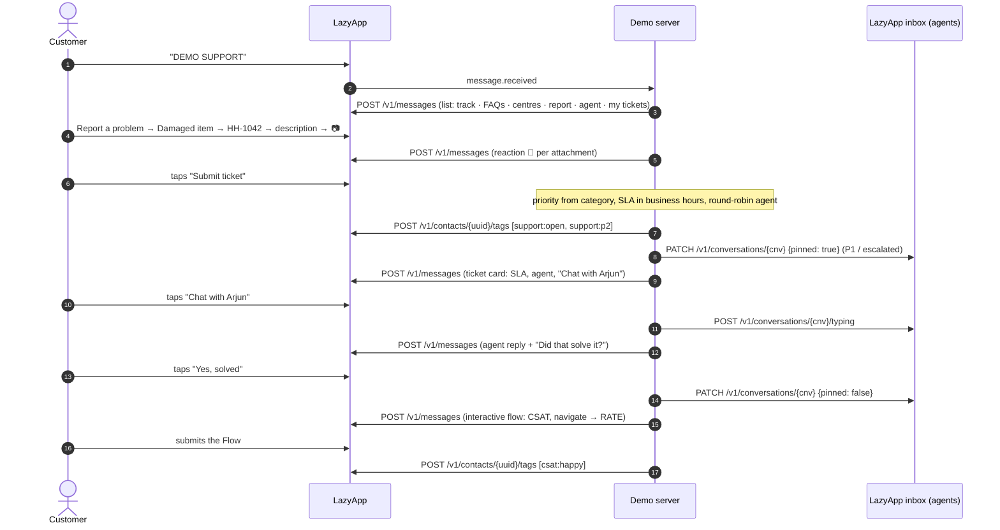

# Halo Home Care (customer support desk)

A support desk for a D2C appliance brand, built the way the best Indian support teams run WhatsApp: **self-service first** (FAQs, live order tracking, the nearest service centre), and when a person is needed, a ticket that arrives with the order, the description and the photos already attached, routed by priority to the right team, on an SLA clock that only runs in business hours. Escalations, out-of-hours queuing with an opt-in "notify me", a CSAT survey Flow and reopening complete the loop. LazyApp's inbox is kept in step (P1 and escalated threads pinned, contact tags, the console assignee shown back to the customer), so human agents and the bot see the same picture.

## Try it

Send **`DEMO SUPPORT`** (or `/support`) to the demo number, then:

1. **Track an order** → `HH-1057` (out for delivery, with a tracking link), or type `hh1042`.
2. Ask in your own words: _"how long do refunds take"_, _"can I pay with emi"_, _"I want to talk to a human"_.
3. **Report a problem** → _Damaged or wrong item_ → `HH-1042` → describe it → send a photo → _Submit ticket_.
4. **Chat with Arjun** → _No, escalate_ → _Chat with Rohan_ → _Yes, solved_ → rate it in the CSAT Flow.
5. **My tickets** → open the ticket → _Reopen ticket_.
6. **Find a service centre** → share your location.

Try it after 9 pm IST to see out-of-hours queuing and _Notify me_.

## The conversation



## Meta features used

| Feature                      | Where                                                       | LazyApp API                                                           |
| ---------------------------- | ----------------------------------------------------------- | --------------------------------------------------------------------- |
| List messages                | Main menu, FAQs, sample orders, topics, my tickets          | `POST /v1/messages` `interactive.type: list`                          |
| Reply buttons                | Order card, ticket card, resolution, CSAT fallback          | `interactive.type: button`                                            |
| CTA URL button               | "Track shipment" (served by the demo server)                | `interactive.type: cta_url`                                           |
| Inbound media                | Photos, videos, invoices attached to tickets                | `message.received` (`image`, `video`, `document`)                     |
| Reactions                    | 📎 per attachment, 👍 on a helpful FAQ, 🎉 on resolution    | `type: reaction`                                                      |
| Location request + location  | Nearest service centre                                      | `interactive.type: location_request_message`, `type: location`        |
| Contact card                 | The service centre, one tap to save                         | `type: contacts`                                                      |
| Typing indicator             | Every message (router), and "agent typing"                  | `POST /v1/messages/{uuid}/read`, `POST /v1/conversations/{id}/typing` |
| WhatsApp Flow                | CSAT survey (rating, what went well, comment)               | `interactive.type: flow` (navigate with data)                         |
| Utility template + `send_at` | "Notify me" when the desk opens, with a quick-reply payload | `POST /v1/messages` `type: template, send_at`                         |
| Contact tags                 | `support:open/resolved/escalated/p1`, `csat:happy/unhappy`  | `POST` / `DELETE /v1/contacts/{uuid}/tags`                            |
| Inbox                        | Pin P1 and escalated threads; show the console assignee     | `PATCH /v1/conversations/{id}`, `GET /v1/conversations/{id}`          |
| Conversation starter command | `/support`                                                  | `PUT /v1/connections/{uuid}/conversation-starters`                    |

## How routing works

| Topic                                     | Priority | First reply within   | Team            |
| ----------------------------------------- | -------- | -------------------- | --------------- |
| Order not delivered                       | P1       | 15 min               | Priority desk   |
| Payment issue                             | P1       | 15 min               | Priority desk   |
| Damaged or wrong item                     | P2       | 1 h (photo required) | Customer care   |
| Installation, refund, product not working | P2       | 1 h                  | Customer care   |
| Something else                            | P3       | 4 h                  | General support |

- The SLA clock runs **Mon–Sat, 9 am–9 pm IST** only (`src/hours.ts`): a P2 raised at 8:30 pm is due at 9:30 am the next working day.
- Agents are picked round robin within the team. After hours, tickets queue and are assigned at the next opening.
- A missed first-reply SLA escalates the ticket to the team lead automatically, bumps its priority and starts a shorter clock. "No, escalate" does the same on request, once.
- Time-based rules are applied **lazily** whenever a ticket is read (`TicketDesk.get`), so there is no scheduler process, and replays are harmless.
- Resolved tickets can be reopened for 7 days; they go back to the same agent with the full history.

## LazyApp API calls

```http
POST /v1/contacts/{uuid}/tags          { "tags": ["support:open", "support:p1"] }
DELETE /v1/contacts/{uuid}/tags        { "tags": ["support:open", "support:escalated"] }
PATCH /v1/conversations/{cnv_id}       { "pinned": true }        Idempotency-Key: <event>:support-desk:pin
POST /v1/conversations/{cnv_id}/typing
GET /v1/conversations/{cnv_id}         → { "assignee": { "id": 7, "name": "Priya S" } | null, … }

POST /v1/messages                      (scheduled "notify me")
{ "type": "template", "to": "+91…", "send_at": "2026-10-24T03:32:00.000Z",
  "template": { "name": "demo_support_desk_ticket_update", "language": "en", "components": [
    { "type": "body", "parameters": [{ "type": "text", "text": "Asha" }, { "type": "text", "text": "SUP-48211" },
      { "type": "text", "text": "Meera from our priority desk team has picked it up and will reply shortly." }] },
    { "type": "button", "sub_type": "quick_reply", "index": "0", "parameters": [{ "type": "payload", "payload": "tview:SUP-48211" }] } ] },
  "metadata": { "demo": "support-desk", "session": "…", "follow_up": "ticket-SUP-48211" } }
DELETE /v1/messages/scheduled/{id}     (on EXIT / STOP / expiry)
```

Template created by `npm run setup`:

| Name                              | Category | Body                                                                                                                      |
| --------------------------------- | -------- | ------------------------------------------------------------------------------------------------------------------------- |
| `demo_support_desk_ticket_update` | UTILITY  | Hi {{1}}, there is an update on your Halo Home ticket {{2}}: {{3}} Reply here to continue the conversation with our team. |

## Fallbacks

- **CSAT Flow not published**: three rating buttons (😍 / 😐 / 😞) record the same score.
- **Inbox API unavailable** (pin, typing, assignee): logged and skipped; the customer never notices.
- **Contact tags unavailable**: logged and skipped.
- **Next shift more than a day away** (Saturday night): the demo says it cannot schedule the update, because sessions end after 24 quiet hours. A real desk would send it.

## Platform gaps found

| Endpoint                       | Problem                                                                                                                                                                                                                                                                                                           | Suggested fix                                                                                                                            |
| ------------------------------ | ----------------------------------------------------------------------------------------------------------------------------------------------------------------------------------------------------------------------------------------------------------------------------------------------------------------- | ---------------------------------------------------------------------------------------------------------------------------------------- |
| `PATCH /v1/conversations/{id}` | Only `archived` and `pinned` can be set. There is no way to **assign** an agent or set the conversation **status** (`open` / `pending` / `resolved`) from the API, although `GET /v1/conversations` filters by both. A bot that triages and routes cannot hand the thread to the right person in LazyApp's inbox. | Accept `assignee_id` (and a team), `status`, and labels on `PATCH`, and emit `conversation.assigned` / `conversation.resolved` webhooks. |
| `GET /v1/conversations/{id}`   | No internal notes and no way to add one, so the bot cannot leave the ticket summary for the human agent next to the thread.                                                                                                                                                                                       | `POST /v1/conversations/{id}/notes` (visible to agents only).                                                                            |
| `POST /v1/events`              | Every business event is dispatched as a mapped template message, so it cannot be used to log "ticket created" for analytics or workflows without messaging the customer.                                                                                                                                          | A `record_only` flag (or events without a mapping that only feed analytics and workflows).                                               |

## Run it yourself

```bash
npm run setup -- --only support-desk     # creates the ticket-update template and the CSAT flow
DEMO_EXAMPLES=support-desk npm run dev
open http://localhost:8787/x/support-desk/track/HH-1057
npx vitest run examples/support-desk
```

No extra environment variables. The API key needs `messages:send` and `messages:read` (conversations, tags), plus `templates:write` for setup.
