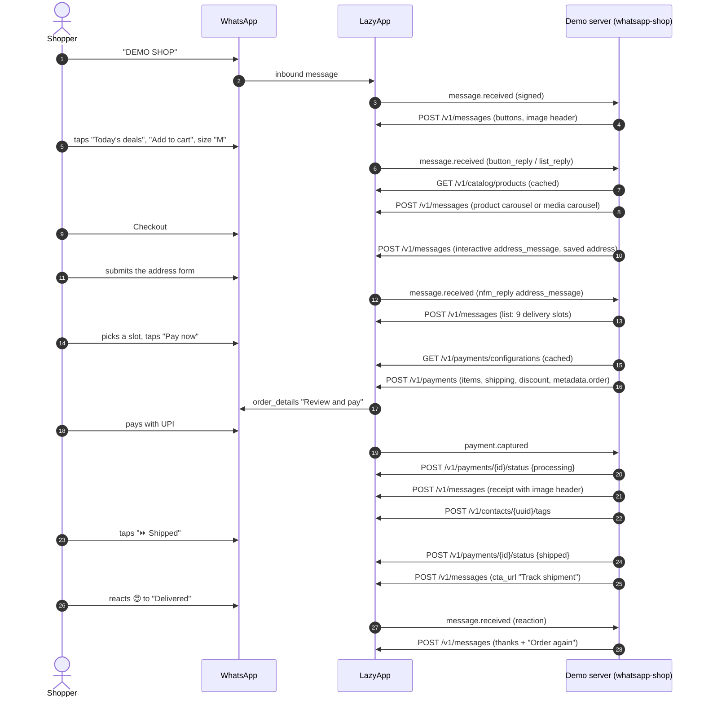

# WhatsApp Shop: a complete D2C store in a chat

**Indigo Loom** is a fictional Jaipur handloom brand that sells sarees, dresses, bedding and bags entirely inside WhatsApp. The shopper browses the catalog, searches by typing, picks sizes, fills in an address with WhatsApp's native India address form, chooses a delivery slot, pays with any UPI app or card without leaving the chat (or picks cash on delivery), gets a receipt, follows the order to the door, rates it with an emoji and books a return through a Flow. Nothing is a mock-up: every message is one call to the LazyApp API, and every capability has a fallback so the demo works on a bare number too.

It is built for D2C brands, marketplaces' long tail and Instagram sellers who already do their business in WhatsApp DMs and want the same conversation to take orders and money properly.

## Try it

Send **`DEMO SHOP`** (or `/shop`) to the LazyApp demo number. Then:

1. **Today's deals** → swipe the carousel → **Add to cart** on the dress → pick a size.
2. Type **`silk saree`**: free text is a search.
3. **View cart** → **Checkout** → fill in the address form → pick a slot → **Pay now** (or **Cash on delivery**).
4. On the receipt tap **Track order**, then **⏩** to play the courier: packed, shipped (tracking link), out for delivery (courier contact card), delivered.
5. React 😍 to the "Delivered" message, then **MENU → Returns & exchanges** to book a pickup with the Flow.

`MENU` shows the menu, `EXIT` leaves, `STOP` leaves and opts out.

## The conversation



## Meta features used

| Feature                               | Where in the flow                                              | LazyApp API                                                                     |
| ------------------------------------- | -------------------------------------------------------------- | ------------------------------------------------------------------------------- |
| Reply buttons with image header       | Welcome, product card, receipt                                 | `POST /v1/messages` `interactive.type: button`, `header.type: image`            |
| List messages                         | Collections, products, sizes, slots, orders, ratings           | `interactive.type: list`                                                        |
| Multi-product message                 | Collections and search results (with a catalog)                | `interactive.type: product_list`                                                |
| Single-product message                | Product details (with a catalog)                               | `interactive.type: product`                                                     |
| Product carousel                      | Today's deals (with a catalog)                                 | `interactive.type: carousel`, `cards[].type: product`                           |
| Media carousel with quick replies     | Today's deals (without a catalog)                              | `interactive.type: carousel`, image cards, `quick_reply` buttons                |
| Catalog cart (`order` message)        | Shopper sends the native cart                                  | inbound `type: order` → merged into the shop cart                               |
| India address message                 | Checkout address, with the last address saved                  | `interactive.type: address_message`, `saved_addresses`, `validation_errors`     |
| WhatsApp Flow (navigate)              | Address form for non-Indian numbers                            | `interactive.type: flow`, `flow_action: navigate`                               |
| WhatsApp Flow (data_exchange)         | Returns & exchanges: items, reasons, refund quote              | `POST /flows/whatsapp-shop/returns` data endpoint, `flow_action: data_exchange` |
| Payments (India) `order_details`      | Pay now: UPI apps, cards, netbanking                           | `POST /v1/payments` with `payment.method: payment_gateway`                      |
| Payment link fallback                 | When only a gateway account is configured                      | `POST /v1/payments` with `payment.method: payment_link`, `gateway_account`      |
| Order status                          | Processing → shipped → completed                               | `POST /v1/payments/{id}/status`                                                 |
| CTA URL button                        | "Track shipment"                                               | `interactive.type: cta_url`                                                     |
| Contact cards                         | Courier when out for delivery, care team on handoff            | `type: contacts`                                                                |
| Reactions (sent)                      | 🛍️ on add to cart, 🛒 on a catalog cart, ✅ on the order       | `type: reaction`                                                                |
| Reactions (received)                  | An emoji on "Delivered" becomes a star rating                  | inbound `type: reaction`                                                        |
| Read receipts + typing                | Every inbound message (router)                                 | `POST /v1/messages/{uuid}/read` `{ typing: true }`                              |
| Marketing template + `send_at`        | Abandoned-cart reminder, after an in-chat opt-in               | `POST /v1/contacts/{uuid}/consent`, `POST /v1/messages` `send_at`               |
| Limited-time offer + copy-code coupon | "Get the coupon", after an in-chat opt-in                      | template `features.coupon_code`, `features.offer_expires_at`                    |
| Template quick replies                | "View my cart" / "Stop reminders" on the reminder              | `components[].sub_type: quick_reply` payloads routed back as buttons            |
| Contact tags                          | `demo-shop-customer`, `demo-shop-support`, `demo-shop-unhappy` | `POST /v1/contacts/{uuid}/tags`                                                 |
| Conversation starter + QR             | `/shop`, QR prefilled with `DEMO SHOP`                         | `PUT /v1/connections/{uuid}/conversation-starters`, `POST …/qr-codes` (setup)   |

## LazyApp API calls

Every write carries a deterministic `Idempotency-Key` derived from the inbound event, so a redelivered webhook never double-sends or double-charges.

```http
POST /v1/payments
{
  "to": "+919800000001",
  "reference_id": "IL482913",
  "body": "Order IL482913 from Indigo Loom. Check the items and pay securely with any UPI app or card.",
  "footer": "LazyApp demo store",
  "header_image_url": "https://images.unsplash.com/…",
  "goods_type": "physical-goods",
  "importer": { "name": "Indigo Loom Crafts Pvt Ltd", "address": { "address_line1": "…", "city": "Jaipur", "zone_code": "RJ", "postal_code": "302022", "country_code": "IN" } },
  "expires_in_minutes": 30,
  "items": [{ "name": "Bandhani maxi dress, red (M)", "amount": 189900, "quantity": 1, "retailer_id": "il-dress-bandhani-red", "country_of_origin": "India" }],
  "discount": { "amount": 20000, "description": "Coupon FESTIVE200", "program_name": "FESTIVE200" },
  "payment": { "method": "payment_gateway", "configuration": "demo-store" },
  "metadata": { "demo": "whatsapp-shop", "order": "IL482913" }
}

POST /v1/payments/{id}/status   { "status": "shipped", "description": "Shipped with BlueRoute Express, AWB DL3F9A…" }

POST /v1/messages               { "type": "template", "template": { "name": "demo_whatsapp_shop_festive_offer", "language": "en",
                                  "components": [{ "type": "body", "parameters": [{ "type": "text", "text": "Asha" }, { "type": "text", "text": "₹200" }] }],
                                  "features": { "coupon_code": "FESTIVE200", "offer_expires_at": "2026-10-25T03:30:00.000Z" } } }

POST /v1/messages               { "type": "template", "send_at": "<now + 3h>", "template": { "name": "demo_whatsapp_shop_cart_reminder", … } }
DELETE /v1/messages/scheduled/{id}     (checkout, EXIT, STOP or "Stop reminders")

POST /v1/contacts/{uuid}/consent      { "granted": true, "channel": "whatsapp", "purpose": "marketing", "consent_text": "Yes, send me cart reminders…" }
POST /v1/contacts/{uuid}/tags         { "tags": ["demo-shop-customer"] }
GET  /v1/catalog/products             (cached 10 min; only SKUs from this shop are used)
GET  /v1/payments/configurations      (cached 10 min)
```

Templates (`npm run setup` submits them):

| Template                           | Category                                       | Body                                                                                   |
| ---------------------------------- | ---------------------------------------------- | -------------------------------------------------------------------------------------- |
| `demo_whatsapp_shop_cart_reminder` | Marketing, text header, 2 quick replies        | "Hi {{1}}, you left {{2}} in your Indigo Loom cart. Orders above ₹1,499 ship free…"    |
| `demo_whatsapp_shop_festive_offer` | Marketing, limited-time offer, copy code + URL | "Hi {{1}}, your festive coupon is ready: {{2}} off handloom sarees, bedding and more…" |

Flows: `demo_whatsapp_shop_returns` (data_exchange, `CUSTOMER_SUPPORT`) and `demo_whatsapp_shop_address` (navigate, `SHOPPING`).

## Fallbacks

| Missing                                             | What the shopper gets                                                                                  |
| --------------------------------------------------- | ------------------------------------------------------------------------------------------------------ |
| No catalog, or none of the shop's SKUs in it        | Collections and products as list messages, deals as an image carousel with "Add to cart" quick replies |
| No payment configuration                            | "Online payment is not set up on this demo number yet…" and a cash-on-delivery confirmation            |
| Only a Cashfree/Razorpay gateway account            | `payment_link` order details, and a line saying it opens a secure link                                 |
| `POST /v1/payments` refused (terms not accepted, …) | The reason in plain words, and cash on delivery                                                        |
| Payment failed                                      | "No money was taken", **Try again** (new order id) or **Cash on delivery**                             |
| Non-Indian number (no address messages)             | The address Flow; without it, a typed address parsed for the PIN code                                  |
| Returns Flow not published                          | Item → refund/exchange → size → reason, as buttons and lists                                           |
| Offer template not approved yet                     | `message.failed` arrives; the shopper gets the code as text (it is already applied)                    |
| COD not possible (remote PIN, > ₹10,000)            | Only "Pay now", with the reason                                                                        |

## Code tour

| File                      | What it holds                                                                        |
| ------------------------- | ------------------------------------------------------------------------------------ |
| `src/index.ts`            | `defineExample`, the inbound switch and the button-id router (`area:action:arg`)     |
| `src/catalog.ts`          | Seed products, search ranking, which SKUs the Meta catalog can show                  |
| `src/pricing.ts`          | Paise-only pricing: shipping, coupons, COD fee, the bill text                        |
| `src/delivery.ts`         | Slots in IST, PIN serviceability, address-message parsing and `validation_errors`    |
| `src/browse.ts` `cart.ts` | Browsing, carousels, search; cart, sizes, coupons, the opt-in reminder               |
| `src/checkout.ts`         | Address → slot → payment, `POST /v1/payments`, `payment.captured` / `payment.failed` |
| `src/fulfilment.ts`       | Orders, tracking, simulated courier, order-status sync, ratings, reorder             |
| `src/returns.ts`          | The returns Flow endpoint and its button fallback, sharing one pure `planReturn`     |
| `src/engagement.ts`       | Limited-time offer, human handoff, failed-send recovery                              |
| `src/cli/sync-catalog.ts` | Uploads the seed to the number's Meta catalog with `POST /v1/catalog/items`          |
| `test/*.test.ts`          | 50+ conversation and domain tests against the in-memory LazyApp                      |

## Run it yourself

```bash
npm run setup -- --only whatsapp-shop          # templates, flows, /shop command, QR code
DEMO_EXAMPLES=whatsapp-shop npm run dev
npx vitest run examples/whatsapp-shop

# Optional: put the products in the number's Meta catalog (needs catalog:write)
npm run sync-catalog -w @lazyapp-examples/example-whatsapp-shop -- --dry-run
npm run sync-catalog -w @lazyapp-examples/example-whatsapp-shop
```

| Env                       | Needed for                                                                           |
| ------------------------- | ------------------------------------------------------------------------------------ |
| `PAYMENT_CONFIGURATION`   | In-WhatsApp payments. Auto-detected when the workspace has one active configuration. |
| `PAYMENT_GATEWAY_ACCOUNT` | Payment-link fallback (Cashfree/Razorpay gateway account id in LazyApp).             |
| `LAZYAPP_PHONE_NUMBER_ID` | Which number's catalog and payments to use when the workspace has several.           |

API key scopes: `messages:send`, `messages:read`, `templates:write`, `payments:write` (refunds and setup only), `catalog:write` (only for `sync-catalog`).

## Limitations

- **The courier is simulated.** ⏩ moves the order one step, so anyone can see every message a real store sends. In production, call the same functions from your warehouse or courier webhooks.
- **Receipts are messages, not PDFs.** The demo server has no route for example-generated files, and the SDK has no multipart upload for `POST /v1/media`, so the receipt is an itemised message with the product photo.
- **Order status updates need in-WhatsApp payment.** `POST /v1/payments/{id}/status` needs a payment order, so COD and payment-link orders get the same updates as regular messages.
- **Catalog writes need Meta approval** for LazyApp's `catalog_management` permission; until then upload the seed in Commerce Manager.
